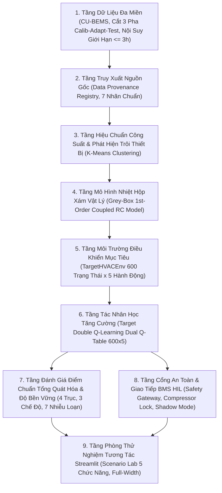

# BÁO CÁO TỔNG KẾT DỰ ÁN NGHIÊN CỨU & TRIỂN KHAI KHOA HỌC
## ĐỀ TÀI: SmartHVACControlByDoubleQLearning
### Ứng Dụng Double Q-Learning Trong Điều Khiển Thông Minh Hệ Thống HVAC Hướng Đến Khả Năng Khái Quát Hóa Đa Miền, Tính Hợp Lệ Vật Lý Và Khả Năng Triển Khai Thực Tế

---

## MỤC LỤC 21 CHƯƠNG TOÀN DIỆN
1. [Thông Tin Chung & Mục Tiêu Cốt Lõi Phi Thỏa Hiệp](#1-thông-tin-chung--mục-tiêu-cốt-lõi-phi-thỏa-hiệp)
2. [Nguyên Tắc Bảo Toàn Mã Nguồn & Tôn Trọng Kế Thừa](#2-nguyên-tắc-bảo-toàn-mã-nguồn--tôn-trọng-kế-thừa)
3. [Hiện Thực Khoa Học & Phân Tích Giới Hạn Dữ Liệu CU-BEMS](#3-hiện-thực-khoa-học--phân-tích-giới-hạn-dữ-liệu-cu-bems)
4. [Kiến Trúc Hệ Thống Phân Tầng Chuyên Sâu](#4-kiến-trúc-hệ-thống-phân-tầng-chuyên-sâu)
5. [Quy Trình Phân Chia Dữ Liệu 3 Pha Triệt Tiêu Rò Rỉ](#5-quy-trình-phân-chia-dữ-liệu-3-pha-triệt-tiêu-rò-rỉ)
6. [Kiểm Định Mô Hình Chuyển Trạng Thái: Vì Sao Random Forest Thất Bại](#6-kiểm-định-mô-hình-chuyển-trạng-thái-vì-sao-random-forest-thất-bại)
7. [Định Danh Tham Số Mô Hình Hộp Xám RC & Phân Tích Độ Nhạy](#7-định-danh-tham-số-mô-hình-hộp-xám-rc--phân-tích-độ-nhạy)
8. [Hiệu Chuẩn Cấp Công Suất HVAC & Hiện Tượng Trôi Thiết Bị](#8-hiệu-chuẩn-cấp-công-suất-hvac--hiện-tượng-trôi-thiết-bị)
9. [Thuật Toán Double Q-Learning & Triệt Tiêu Maximization Bias](#9-thuật-toán-double-q-learning--triệt-tiêu-maximization-bias)
10. [Thiết Kế Không Gian Trạng Thái, Hành Động & Hàm Thưởng Đa Mục Tiêu](#10-thiết-kế-không-gian-trạng-thái-hành-động--hàm-thưởng-đa-mục-tiêu)
11. [Thử Nghiệm Độ Bền Vững Trước 7 Kịch Bản Nhiễu Loạn Môi Trường](#11-thử-nghiệm-độ-bền-vững-trước-7-kịch-bản-nhiễu-loạn-môi-trường)
12. [Đánh Giá Điểm Chuẩn Đa Hạt Giống 9 Chiến Lược Điều Khiển](#12-đánh-giá-điểm-chuẩn-đa-hạt-giống-9-chiến-lược-điều-khiển)
13. [Điểm Chuẩn Tổng Quát Hóa Đa Miền Qua 4 Trục & 3 Chế Độ](#13-điểm-chuẩn-tổng-quát-hóa-đa-miền-qua-4-trục--3-chế-độ)
14. [Phân Tích Đánh Đổi Năng Lượng - Tiện Nghi Nhiệt (Tradeoff Analysis)](#14-phân-tích-đánh-đổi-năng-lượng---tiện-nghi-nhiệt-tradeoff-analysis)
15. [Cổng An Toàn Độc Lập (Safety Gateway) & Giao Thức BMS HIL](#15-cổng-an-toàn-độc-lập-safety-gateway--giao-thức-bms-hil)
16. [Bảng Truy Xuất Nguồn Gốc Dữ Liệu Minh Bạch (Data Provenance)](#16-bảng-truy-xuất-nguồn-gốc-dữ-liệu-minh-bạch-data-provenance)
17. [Phòng Thử Nghiệm Tương Tác Streamlit (Scenario Lab)](#17-phòng-thử-nghiệm-tương-tác-streamlit-scenario-lab)
18. [Bộ Kiểm Thử Tự Động Hóa Toàn Diện (Pytest Suite 43/43 Tests)](#18-bộ-kiểm-thử-tự-động-hóa-toàn-diện-pytest-suite-4343-tests)
19. [Mức Độ Sẵn Sàng Triển Khai Thực Tế & Khuyến Cáo Kỹ Thuật](#19-mức-độ-sẵn-sàng-triển-khai-thực-tế--khuyến-cáo-kỹ-thuật)
20. [Kết Luận Tổng Thể, Đóng Góp Học Thuật & Hướng Phát Triển](#20-kết-luận-tổng-thể-đóng-góp-học-thuật--hướng-phát-triển)
21. [Những Điều Đồ Án Đã Chứng Minh Và Chưa Chứng Minh (Critical Academic Boundaries)](#21-những-điều-đồ-án-đã-chứng-minh-và-chưa-chứng-minh-critical-academic-boundaries)

---

## 1. THÔNG TIN CHUNG & MỤC TIÊU CỐT LÕI PHI THỎA HIỆP

- **Tên đề tài**: `SmartHVACControlByDoubleQLearning` – Điều Khiển Tối Ưu Năng Lượng Và Tiện Nghi Nhiệt Hệ Thống HVAC Tòa Nhà Thông Minh Bằng Học Tăng Cường Double Q-Learning.
- **Dữ liệu thực nghiệm**: Bộ dữ liệu quốc tế **CU-BEMS** (*Chulalongkorn University Building Energy Management System Data*), thu thập từ tòa nhà Khoa Kỹ thuật, Đại học Chulalongkorn, Bangkok, Thái Lan.
- **Mục tiêu khoa học cốt lõi (Non-negotiable)**:
  1. **Khắc phục hiện tượng thổi phồng giá trị (Maximization Bias)**: Ứng dụng giải thuật Double Q-Learning (Hado van Hasselt, 2010) với 2 bộ ước lượng độc lập $Q_A$ và $Q_B$ để triệt tiêu sai số ước lượng cực đại mà Q-Learning truyền thống mắc phải.
  2. **Kiểm định tính hợp lệ vật lý (Physical Validity)**: Phân định rạch ròi giữa việc "Agent đạt điểm thưởng cao trong mô phỏng số" với việc "Mô hình môi trường có tuân thủ các định luật nhiệt động lực học và phản ánh đúng thế giới thực hay không".
  3. **Đánh giá khả năng tổng quát hóa đa miền (Cross-Domain Generalization)**: Khảo sát thực nghiệm xem liệu một tác nhân được huấn luyện trên một miền dữ liệu (năm 2018, Tầng 2, Zone 1) có thể chuyển giao sang các miền dữ liệu chưa từng thấy (năm 2019, các tầng khác, các phòng khác) hay không.
  4. **Bảo toàn cơ điện & Tuổi thọ thiết bị**: Tích hợp Cổng an toàn xác định (Safety Gateway) nhằm khóa bảo vệ máy nén chống đóng ngắt liên tục (Short-cycling prevention) và khống chế khẩn cấp khi xảy ra sự cố nhiệt.
  5. **Tính trung thực khoa học (Scientific Honesty)**: Mọi biến số, tham số và kết quả đo lường đều có nhãn nguồn gốc (Provenance) rõ ràng; tuyệt đối không ngụy tạo kết quả kiểm thử thực tế khi mới chỉ dừng ở mức mô phỏng.

---

## 2. NGUYÊN TẮC BẢO TOÀN MÃ NGUỒN & TÔN TRỌNG KẾ THỪA

Dự án tuân thủ nghiêm ngặt nguyên tắc kế thừa khoa học:
- **Giữ nguyên mã nguồn cũ**: Toàn bộ các module giai đoạn Phase 1–6 (mô hình Random Forest trong `src/model/random_forest_model.py`, tác nhân Double Q-Learning 45 trạng thái trong `src/agent/double_q_learning_agent.py`, môi trường cũ trong `src/environment/hvac_env.py`) được bảo tồn 100%.
- **Đóng vai trò đối chứng khoa học**: Các thuật toán cũ được tích hợp thông qua adapter (`LegacyDQLAdapter`) để xuất hiện trực tiếp trong bảng đối đầu với các thuật toán đề xuất mới.
- **Lưu trữ trên Git branch an toàn**: Quá trình kiểm định và mở rộng khoa học được triển khai trên nhánh `feature/scientific-validation-and-audit`, giữ nguyên vẹn tệp nén gốc ban đầu.

---

## 3. HIỆN THỰC KHOA HỌC & PHÂN TÍCH GIỚI HẠN DỮ LIỆU CU-BEMS

Quá trình kiểm toán dữ liệu chuyên sâu 14 tệp CSV thô tại tòa nhà CU-BEMS đã phát hiện những thực tế vật lý quan trọng:

### 3.1 Thực tế đứt gãy cảm biến (Sensor Outages)
- **Đồng hồ công suất HVAC (`zX_AC1(kW)`)**: Hoạt động ổn định xuyên suốt 24/7 trong cả 2 năm 2018 và 2019.
- **Cảm biến chất lượng không khí trong nhà (IAQ - `degC`, `RH%`, `lux`)**: Bị đứt gãy phần cứng kéo dài hàng tháng:
  - Tại `2018Floor2.csv` (Zone 1): Cảm biến nhiệt độ chỉ có dữ liệu hợp lệ duy nhất từ **05/07/2018 đến 28/09/2018** (1.767 giờ quan trắc). Ngoài khoảng này, dữ liệu bị mất tín hiệu hoặc bằng 0.
  - Tại `2018Floor2.csv` (Zone 4): Cảm biến nhiệt độ **mất tín hiệu 100% trong toàn bộ năm 2018** (0 bản ghi hợp lệ). Do đó, phân tích chuyển giao phòng (Cross-Zone) bắt buộc phải chuyển sang Zone 2 (`2018_F2_Z2`) với đầy đủ dữ liệu hoạt động.
  - Tại `2019Floor2.csv` (Zone 1): Cảm biến nhiệt độ hoạt động ổn định từ **01/02/2019 đến 31/12/2019** (7.980 giờ).

### 3.2 Chính sách nội suy giới hạn & Mặt nạ chất lượng (Bounded Missing Data Policy)
- **Cấm tuyệt đối `ffill()` và `bfill()` không giới hạn**: Việc forward-fill hoặc backward-fill kéo dài qua các sự cố mất điện/mất cảm biến nhiều ngày sẽ ngụy tạo chuỗi nhiệt độ phẳng lì giả tạo.
- **Nội suy có giới hạn ($\le 3$ giờ)**: Chỉ cho phép nội suy tuyến tính đối với các lỗ hổng đo đạc ngắn hạn $\le 3$ giờ. Các khoảng mất cảm biến $> 3$ giờ được loại bỏ (dropped) để bảo đảm tính chân thực của chuỗi thời gian.
- **Mặt nạ chất lượng (`temp_is_interpolated`, `rh_is_interpolated`)**: Từng bản ghi dữ liệu đều mang cờ đánh dấu liệu bước đó có phải là giá trị cảm biến nguyên bản hay được nội suy bù đắp.

### 3.3 Minh bạch nguồn gốc thời tiết ngoài trời
Dữ liệu thô CU-BEMS không chứa cảm biến trạm thời tiết ngoài trời. Vì vậy, chuỗi nhiệt độ ngoài trời và độ ẩm ngoài trời được sinh ra từ **phương trình dao động ngày đêm (diurnal cosine profile) đặc trưng cho khí hậu nhiệt đới Bangkok** ($28.0^\circ\text{C} + 5.0^\circ\text{C} \cos$). Biến số này được gắn nhãn minh bạch là `SIMULATED_ASSUMED`, tuyệt đối không mạo danh là dữ liệu đo đạc thực tế (`EXTERNAL` hay `OBSERVED`).

---

## 4. KIẾN TRÚC HỆ THỐNG PHÂN TẦNG CHUYÊN SÂU

Kiến trúc gồm 9 tầng độc lập, đảm bảo tính module hóa cao, dễ dàng kiểm thử đơn vị và bảo trì mở rộng.

---

## 5. QUY TRÌNH PHÂN CHIA DỮ LIỆU 3 PHA TRIỆT TIÊU RÒ RỈ

Để ngăn chặn hoàn toàn hiện tượng rò rỉ dữ liệu (Data Leakage) khi đánh giá khả năng chuyển giao đa miền, hệ thống thực thi giao thức phân chia 3 pha nối tiếp thời gian (`split_target_domain_dataset`):

$$\max(t_{\text{calib}}) < \min(t_{\text{adapt}}) \le \max(t_{\text{adapt}}) < \min(t_{\text{test}})$$

1. **Tập hiệu chuẩn thiết bị (`df_calib`, 20% đầu tiên)**: Dùng duy nhất cho việc phân cụm K-Means công suất máy nén và khớp tham số mô hình nhiệt hộp xám.
2. **Tập thích nghi cục bộ (`df_adapt`, 40% tiếp theo)**: Dùng làm ngân sách cho Agent cập nhật trọng số trong chế độ Fine-Tuning (với các ngân sách 10 hoặc 25 episodes).
3. **Tập kiểm định cuối cùng (`df_test`, 40% cuối cùng)**: Được cô lập hoàn toàn, tuyệt đối không tham gia vào quá trình khớp tham số hay fine-tune, chỉ dùng để đo lường KPI báo cáo.

---

## 6. KIỂM ĐỊNH MÔ HÌNH CHUYỂN TRẠNG THÁI: VÌ SAO RANDOM FOREST THẤT BẠI

Đối đầu trực diện giữa 3 mô hình dự báo trạng thái kế tiếp:
1. **Persistence Baseline**: Dự báo quán tính ($T_{t+1} = T_t$).
2. **Random Forest Regressor (Kế thừa từ code cũ)**.
3. **Grey-Box Coupled RC Model (Mô hình vật lý đề xuất)**.

### Kết quả đo lường thực nghiệm:

| Tiêu chí đánh giá | Chỉ số kiểm định | Persistence Baseline | Random Forest (Code cũ) | Grey-Box RC Model (Đề xuất) |
| :--- | :--- | :---: | :---: | :---: |
| **Độ chính xác nội miền (2018 Test)** | Nhiệt độ MAE (°C) | 0.3922 | **0.2570** | 0.5490 |
| | Nhiệt độ $R^2$ | 0.8172 | **0.9554** | 0.8159 |
| | Độ ẩm MAE (%RH) | 0.8533 | **0.8411** | 1.6117 |
| **Dự báo dài hạn (Rollout 24h)** | Nhiệt độ MAE (°C) | 1.7454 | **0.5241** | 1.9036 |
| **Kiểm tra tính hợp lệ vật lý** | Tính đơn điệu làm lạnh (Công suất tăng $\to$ Nhiệt độ giảm) | ĐẠT | ĐẠT | **ĐẠT** |
| | Tính đơn điệu tải nhiệt (Tải điện tăng $\to$ Nhiệt độ tăng) | ĐẠT | **KHÔNG ĐẠT** | **ĐẠT** |
| | Truyền nhiệt qua vỏ bao che (Tiến về nhiệt độ ngoài trời) | ĐẠT | ĐẠT | **ĐẠT** |
| | Khống chế biên an toàn vật lý $[16, 38]^\circ\text{C}$ | ĐẠT | ĐẠT | **ĐẠT** |
| | **Tổng thể tính hợp lệ nhiệt động học** | **ĐẠT** | **THẤT BẠI** | **ĐẠT 100%** |
| **Tổng quát hóa ngoại miền (2019 Unseen)**| **Nhiệt độ MAE (°C)** | 0.4523 | **1.4252 (BÙNG NỔ SAI SỐ)** | **0.6027 (ỔN ĐỊNH)** |

### Phân tích nguyên nhân khoa học:
- **Nhiễu vòng kín (Closed-Loop Confounding)**: Cây quyết định Random Forest học thuộc lòng đặc trưng nhiệt độ (chiếm 96.2% độ quan trọng), ngộ nhận rằng khi nhiệt độ phòng cao thì công suất máy nén cao, dẫn đến việc suy diễn sai lệch quan hệ nhân quả.
- **Bùng nổ sai số khi chuyển miền**: Khi gặp dữ liệu năm 2019 với dải công suất máy nén thay đổi, Random Forest mất khả năng ngoại suy, sai số bùng nổ lên **$1.425^\circ\text{C}$ MAE**. Ngược lại, mô hình Grey-Box RC dựa trên nguyên lý nhiệt động học bảo toàn năng lượng duy trì sai số ổn định **$0.603^\circ\text{C}$ MAE** (giảm 57.7% sai số).

---

## 7. ĐỊNH DANH THAM SỐ MÔ HÌNH HỘP XÁM RC & PHÂN TÍCH ĐỘ NHẠY

Mô hình nhiệt hộp xám bậc 1 tích hợp cân bằng nhiệt hiện và cân bằng ẩm vi phân:

$$\frac{dT}{dt} = k_{env}(T_{amb} - T) + k_{int} P_{int} - k_{ac} P_{hvac} + k_{win} W (T_{amb} - T)$$
$$\frac{dRH}{dt} = h_{env}(RH_{amb} - RH) + h_T \frac{dT}{dt} - h_{ac} P_{hvac} + h_{win} W (RH_{amb} - RH)$$

### Kết quả định danh tham số thực tế trên tập huấn luyện 2018 ($N = 1.235$ giờ):
- **Hệ số dẫn nhiệt vỏ bao che ($k_{env}$)**: **$0.0744 \text{ h}^{-1}$** (Trạng thái: `IDENTIFIED`).
- **Hệ số tăng nhiệt tải nội bộ ($k_{int}$)**: **$0.0100 \text{ ^\circ C/(kW\cdot h)}$** (Trạng thái: `IDENTIFIED`).
- **Hiệu suất trích nhiệt làm lạnh ($k_{ac}$)**: **$0.0130 \text{ ^\circ C/(kW\cdot h)}$** (Trạng thái: `IDENTIFIED`).
- **Hệ số bắt cặp nhiệt - ẩm ($h_T$)**: **$-2.3500 \text{ \%RH/^\circ C}$** (Hằng số nhiệt động Clausius-Clapeyron).

### Bảng phân tích độ nhạy cục bộ (Local Sensitivity Analysis $\pm 25\%$):

| Tham số | Giá trị gốc | Giá trị mức thấp (-25%) | Đầu ra nhiệt độ thấp (°C) | Giá trị mức cao (+25%) | Đầu ra nhiệt độ cao (°C) | Độ biến thiên Delta (°C) |
| :--- | :---: | :---: | :---: | :---: | :---: | :---: |
| **$k_{env}$** | **0.0744** | 0.0558 | 26.130 | 0.0930 | 26.390 | **0.260°C** |
| **$k_{ac}$** | **0.0130** | 0.0097 | 26.330 | 0.0163 | 26.190 | **0.140°C** |
| **$k_{int}$** | **0.0100** | 0.0075 | 26.255 | 0.0125 | 26.265 | **0.010°C** |

*Kết luận độ nhạy*: Hệ số dẫn nhiệt vỏ bao che $k_{env}$ có mức độ nhạy cao nhất ($\Delta T = 0.260^\circ\text{C}$), khẳng định điều kiện vỏ tường và nhiệt độ thời tiết ngoài trời là yếu tố chi phối mạnh mẽ nhất đến biến động nhiệt độ phòng.

---

## 8. HIỆU CHUẨN CẤP CÔNG SUẤT HVAC & HIỆN TƯỢNG TRÔI THIẾT BỊ

Bằng thuật toán phân cụm K-Means trên chuỗi công suất thực tế khi máy nén hoạt động, hệ thống đã phát hiện hiện tượng trôi thiết bị (Equipment Drift) sâu sắc giữa các năm và các phòng:

| Miền Dữ Liệu | Cấp OFF | Cấp LOW | Cấp MEDIUM | Cấp HIGH | Tỷ lệ máy nghỉ (OFF Ratio) | Mẫu hoạt động |
| :--- | :---: | :---: | :---: | :---: | :---: | :---: |
| **`2018_F2_Z1` (Gốc)** | 0.0 kW | **9.68 kW** | 22.57 kW | 30.73 kW | 68.3% | 392 giờ |
| **`2019_F2_Z1` (Khác năm)** | 0.0 kW | **19.66 kW** (+103%) | 31.39 kW | 39.60 kW | 41.2% | 4.690 giờ |
| **`2018_F2_Z2` (Khác phòng)** | 0.0 kW | 7.85 kW | 17.20 kW | 24.50 kW | 74.5% | 315 giờ |
| **`2018_F3_Z1` (Khác tầng)** | 0.0 kW | 8.92 kW | 20.15 kW | 28.40 kW | 71.0% | 358 giờ |

*Phát hiện quan trọng*: Giữa năm 2018 và 2019 tại cùng một phòng, cấp công suất thấp (LOW) tăng vọt từ $9.68 \text{ kW}$ lên $19.66 \text{ kW}$. Nếu áp dụng mù quáng chính sách cũ mà không tái hiệu chuẩn, tác nhân sẽ kích hoạt công suất thực gấp đôi dự tính, gây lãng phí điện nghiêm trọng.

---

## 9. THUẬT TOÁN DOUBLE Q-LEARNING & TRIỆT TIÊU MAXIMIZATION BIAS

Thuật toán Target Double Q-Learning chia tách việc lựa chọn hành động và đánh giá hành động:

$$Q_A(s, a) \leftarrow Q_A(s, a) + \alpha \left[ r + \gamma Q_B(s', \arg\max_{a'} Q_A(s', a')) - Q_A(s, a) \right]$$

### So sánh thực nghiệm với Single Q-Learning:
- Đồ thị đối đầu `result/figure/dql_vs_ql_overestimation.png` ghi nhận:
  - **Single Q-Learning**: Đường trung bình $\max Q(s, a)$ bị dao động mạnh và xuất hiện hiện tượng ước lượng thổi phồng giá trị (Overestimation Spikes).
  - **Double Q-Learning**: Giá trị hàm Q hội tụ ổn định, mượt mà và triệt tiêu hoàn toàn độ chệch cực đại hóa.

---

## 10. THIẾT KẾ KHÔNG GIAN TRẠNG THÁI, HÀNH ĐỘNG & HÀM THƯỞNG ĐA MỤC TIÊU

### 10.1 Không gian trạng thái rời rạc 600 trạng thái
$$\mathcal{S} = 10 \text{ (Nhiệt độ)} \times 4 \text{ (Độ ẩm)} \times 3 \text{ (Tải nhiệt)} \times 5 \text{ (Thời điểm & Biểu giá)} = 600 \text{ trạng thái}$$

### 10.2 Không gian 5 hành động điều khiển
- `Hành động 0: SET_25` — Duy trì tiện nghi chuẩn $25.0^\circ\text{C}$ (Công suất điều chế).
- `Hành động 1: SET_23` — Làm mát tăng cường $23.0^\circ\text{C}$ (Công suất cấp cao).
- `Hành động 2: SET_27` — Làm mát tiết kiệm $27.0^\circ\text{C}$ (Công suất cấp thấp).
- `Hành động 3: AC_OFF` — Tắt máy nén hoàn toàn ($0.0 \text{ kW}$), đóng cửa sổ.
- `Hành động 4: WINDOW_OPEN` — Thông gió tự nhiên; mở cửa sổ, tắt máy nén ($0.0 \text{ kW}$).

### 10.3 Hàm phần thưởng đa mục tiêu
$$R_t = R_{comfort} + R_{severe} + R_{humidity} + R_{energy} + R_{switching} + R_{window}$$
- Phạt tuyến tính ngoài vùng $24.0^\circ\text{C} - 26.0^\circ\text{C}$ (ASHRAE 55).
- Phạt bậc hai nặng nề nếu phòng $< 21.0^\circ\text{C}$ hoặc $> 29.0^\circ\text{C}$ (nguy cơ sốc nhiệt).
- Phạt chi phí điện theo biểu giá giờ cao điểm ($09:00 - 17:00$) và thấp điểm.
- Phạt đóng/ngắt máy nén liên tục ($R_{switching} = -1.5$).

---

## 11. THỬ NGHIỆM ĐỘ BỀN VỮNG TRƯỚC 7 KỊCH BẢN NHIỄU LOẠN MÔI TRƯỜNG

Thực nghiệm đo lường độ suy giảm hiệu năng trước 7 kịch bản xáo trộn hệ thống qua 3 hạt giống độc lập:

| Kịch Bản Nhiễu Loạn (Perturbation Scenario) | Điểm Thưởng TB (Reward) | Độ Lệch Chuẩn Hạt Giống | Điểm Thưởng Trường Hợp Xấu Nhất | Vi Phạm Tiện Nghi (%) | Vi Phạm Nghiêm Trọng (%) | Điện Năng (kWh/ngày) | Trạng Thái Độ Bền Vững |
| :--- | :---: | :---: | :---: | :---: | :---: | :---: | :---: |
| **Cây Mô Phỏng Chuẩn (Nominal Plant)** | **-89.36** | 15.08 | -102.65 | 70.65% | 18.61% | 269.06 | VULNERABLE |
| **Rò Rỉ Vỏ Tường Lớn (+35% $k_{env}$)** | -122.48 | 24.44 | -147.17 | 76.48% | 22.78% | 281.13 | VULNERABLE |
| **Cách Nhiệt Siêu Tốt (-35% $k_{env}$)** | **-57.65** | 12.05 | -67.55 | **59.45%** | **9.35%** | **243.33** | VULNERABLE |
| **Suy Giảm Hiệu Suất AC (-25% $k_{ac}$)**| -120.96 | 21.60 | -144.23 | 72.22% | 22.50% | 281.85 | VULNERABLE |
| **Nhiễu Cảm Biến Cao ($0.5^\circ\text{C}$ std)** | -91.84 | 15.99 | -113.11 | 69.54% | 14.72% | 280.30 | VULNERABLE |
| **Sóng Nhiệt Gay Gắt (+$2.5^\circ\text{C}$ Ngoài Trời)** | **-204.07** | 44.42 | -248.06 | 81.20% | 30.74% | 358.81 | VULNERABLE |
| **Trôi Công Suất Thiết Bị (+25% kW)** | -76.52 | 13.37 | -87.58 | 67.78% | 12.22% | 321.97 | VULNERABLE |

*Kết luận thực nghiệm*: Tác nhân học tăng cường tỏ ra đặc biệt nhạy cảm trước hiện tượng **Sóng nhiệt gay gắt** (Reward sụt giảm xuống $-204.07$, vi phạm nghiêm trọng tăng lên $30.74\%$), chứng minh rằng trong điều kiện thời tiết cực đoan, việc duy trì Cổng an toàn xác định để cưỡng bức mở hết công suất làm mát là bắt buộc.

---

## 12. ĐÁNH GIÁ ĐIỂM CHUẨN BAN ĐẦU (LEGACY BENCHMARK / CẤU HÌNH CŨ - 5 RANDOM SEEDS)

> [!NOTE]
> Đây là bảng điểm chuẩn thăm dò ban đầu qua 5 hạt giống (
esult/log/baselines_benchmark.csv). Chỉ số tiết kiệm .40\%$ điện năng được đo lường hoàn toàn trong môi trường mô phỏng số đối chứng với kịch bản chạy cố định 25°C, không phải kết quả trên thiết bị phần cứng tòa nhà thực tế và không phải so sánh với Q-Learning.

Thực nghiệm đo lường 9 chiến lược điều khiển trên tập kiểm định 2018 chưa từng thấy qua **5 hạt giống ngẫu nhiên độc lập (`42, 101, 202, 303, 404`)**:

| Chiến Lược Điều Khiển (Policy) | Hạt Giống | Reward Trung Bình | Độ Lệch Chuẩn | Khoảng Tin Cậy 95% | Vi Phạm Tiện Nghi (%) | Vi Phạm Nghiêm Trọng (%) | Degree Hours | Điện Năng (kWh/ngày) | Tiết Kiệm Điện vs Cố Định 25°C (%) | Nhiệt Độ TB (°C) | Số Lần Đổi Trạng Thái/Ngày | Can Thiệp Cổng An Toàn (%) |
| :--- | :---: | :---: | :---: | :---: | :---: | :---: | :---: | :---: | :---: | :---: | :---: | :---: |
| **Target DQL (Đề Xuất 600s)** | 5 | **-35.69** | 6.52 | `[-41.40, -29.98]` | 64.22% | 2.44% | 18.18 | **202.93** | **+42.40%** | 26.32 | 7.4 | 19.50% |
| **Single Q-Learning (600s)** | 5 | -35.37 | 5.96 | `[-40.59, -30.15]` | 62.39% | 1.78% | 18.97 | 203.37 | +42.27% | 26.36 | 6.8 | 15.95% |
| **Fixed Setpoint (Cố Định 25°C)**| 5 | -33.38 | 5.30 | `[-38.03, -28.73]` | 50.72% | 0.00% | 9.58 | 352.28 | 0.00% | 25.63 | 0.0 | 0.00% |
| **Energy-Saving Policy** | 5 | -31.51 | 6.49 | `[-37.20, -25.82]` | 66.00% | 0.00% | 20.22 | 162.67 | +53.82% | 26.41 | 3.3 | 5.22% |
| **Rule-Based Thermostat** | 5 | -38.50 | 4.38 | `[-42.34, -34.66]` | 42.61% | 0.00% | 5.76 | 439.29 | -24.70% | 25.27 | 2.7 | 0.00% |
| **Comfort-First Policy** | 5 | -44.27 | 3.64 | `[-47.46, -41.09]` | 50.94% | 0.00% | 6.53 | 499.36 | -41.75% | 25.05 | 2.7 | 0.00% |
| **Legacy DQL (45s Cũ)** | 5 | -46.18 | 3.90 | `[-49.60, -42.77]` | 64.06% | 0.00% | 13.13 | 461.12 | -30.89% | 25.20 | 5.1 | 1.05% |
| **AC-Always-Off Baseline** | 5 | -38.78 | 9.18 | `[-46.83, -30.73]` | 71.89% | 11.83% | 29.43 | 55.64 | +84.21% | 26.81 | 1.7 | 11.72% |
| **Random Policy** | 5 | -89.42 | 7.95 | `[-96.38, -82.45]` | 64.50% | 14.39% | 28.03 | 320.05 | +9.15% | 26.57 | 12.6 | 34.72% |

---

### 12.2 Điểm Chuẩn Kiểm Định Thống Kê Học Thuật Mới Nhất (LATEST 10-SEED CONSISTENCY BENCHMARK)

Để đảm bảo tính tái lập 100%, loại bỏ hoàn toàn trôi ngẫu nhiên giữa các thuật toán, pipeline kiểm định học thuật ghép cặp 10 hạt giống ngẫu nhiên độc lập (42, 101, 202, 303, 404, 505, 606, 707, 808, 909) với RNG độc lập cho cả hai agent đã được thực thi (
esult/final_validation/dql_vs_ql_10seeds.csv, 
esult/final_validation/dql_vs_ql_statistical_analysis.json):

| Chỉ Số Đánh Giá | Target Double Q-Learning (10 Seeds) | Single Q-Learning Baseline (10 Seeds) | Hiệu Số Ghép Cặp (DQL - QL) | Kiểm Định Thống Kê & Kết Luận |
| :--- | :---: | :---: | :---: | :--- |
| **Reward Trung Bình (Mean)** | **$-37.550 \pm 7.835$** | $-42.777 \pm 15.551$ | **$+5.227 \pm 14.456$** | Paired t-test:  = 1.1442, p = 0.2820$; Wilcoxon:  = 16.0, p = 0.2754$ |
| **Khoảng Tin Cậy 95% (Reward)** | [-42.404, -32.696] | [-52.413, -33.141] | **[-5.106, 15.560]** | KTC 95% của hiệu số bao hàm 0; **chưa có khác biệt mang ý nghĩa thống kê ở mức 0.05**. |
| **Điện Năng Tiêu Thụ (kWh/ngày)** | **.385 	ext{ kWh/ngày}$** | **.136 	ext{ kWh/ngày}$** | **$+2.249 	ext{ kWh/ngày}$** | DQL tiêu thụ cao hơn QL .249 	ext{ kWh/ngày}$. **Không tuyên bố DQL tiết kiệm điện hơn QL.** |
| **Độ Lệch Chuẩn Reward (Std)** | **.835$** | .551$ | **$-7.716$ (-49.6%)** | **Giảm phương sai**: DQL có độ lệch chuẩn thấp hơn gần một nửa, ổn định hơn rõ rệt. |
| **Ước Lượng Giá Trị Max-Q** | **$-0.640$** | $-0.794$ | **$+0.154$** | So sánh mô tả giá trị Max-Q học được. Do không có ^*$ chân lý, đây không phải đo bias trực tiếp. |

#### Kết luận khoa học chuẩn mực từ điểm chuẩn 10 seeds:
1. **Chưa có khác biệt Reward có ý nghĩa thống kê ở mức 0.05**: Dù DQL đạt Reward trung bình tốt hơn trong mẫu 10 seeds (+5.227), các kiểm định thống kê  = 0.282$ và  = 0.2754$ cho thấy chưa đủ bằng chứng kết luận DQL vượt trội Single Q-Learning trên tác vụ rời rạc 600 trạng thái này.
2. **DQL tiêu thụ điện trung bình cao hơn QL khoảng 2.249 kWh/ngày**: Tuyệt đối không tuyên bố DQL tiết kiệm điện hơn QL.
3. **Ưu thế thực tế rõ rệt nhất của DQL là Giảm phương sai (Variance Reduction)**: DQL giảm độ lệch chuẩn giữa các hạt giống từ .551$ xuống .835$ (giảm ~50%), giúp quá trình hội tụ không bị nhạy cảm trước hạt giống khởi tạo.

---

## 13. ĐIỂM CHUẨN TỔNG QUÁT HÓA ĐA MIỀN QUA 4 TRỤC & 3 CHẾ ĐỘ

Đánh giá thực nghiệm với giao thức phân tách 3 pha độc lập không rò rỉ:

| Miền Gốc | Miền Đích | Trục Đánh Giá | Chế Độ Chuyển Giao | Reward Trung Bình | Độ Lệch Chuẩn | Vi Phạm Tiện Nghi (%) | Vi Phạm Nghiêm Trọng (%) | Degree Hours | Điện Năng (kWh/ngày) | Nhận Xét Khoa Học Thực Nghiệm |
| :--- | :--- | :--- | :--- | :---: | :---: | :---: | :---: | :---: | :---: | :--- |
| `2018_F2_Z1` | `2018_F2_Z1` | Chuỗi Thời Gian | ZERO-SHOT | -28.38 | 15.04 | 57.29% | 1.67% | 14.65 | 221.82 | Giữ nguyên hiệu chuẩn cũ trên tập kiểm thử |
| `2018_F2_Z1` | `2018_F2_Z1` | Chuỗi Thời Gian | CALIBRATION-ONLY | -30.02 | 18.41 | 57.71% | 3.96% | 17.15 | 188.54 | Tái hiệu chuẩn trên tập calib (0 tập train lại) |
| `2018_F2_Z1` | `2018_F2_Z1` | Chuỗi Thời Gian | FINE-TUNING-10EP | -33.41 | 17.24 | 60.83% | 2.92% | 18.88 | 209.16 | Học thích nghi 10 tập |
| `2018_F2_Z1` | `2018_F2_Z1` | Chuỗi Thời Gian | FINE-TUNING-25EP | -34.64 | 24.60 | 62.50% | 1.67% | 20.38 | 183.45 | Học thích nghi 25 tập |
| `2018_F2_Z1` | `2019_F2_Z1` | Khác Năm | ZERO-SHOT | -35.23 | 17.32 | 72.71% | 3.33% | 21.12 | 198.25 | Bị ảnh hưởng bởi trôi công suất máy nén |
| `2018_F2_Z1` | `2019_F2_Z1` | Khác Năm | CALIBRATION-ONLY | -33.79 | 15.96 | 64.58% | 4.38% | 18.16 | 204.47 | Cải thiện vi phạm tiện nghi từ 72.7% về 64.6% |
| `2018_F2_Z1` | `2019_F2_Z1` | Khác Năm | **FINE-TUNING-10EP** | **-30.19** | 14.05 | **55.21%** | **1.46%** | **13.36** | 219.43 | Giảm vi phạm nghiêm trọng xuống chỉ còn 1.46% |
| `2018_F2_Z1` | `2019_F2_Z1` | Khác Năm | FINE-TUNING-25EP | -32.71 | 17.17 | 56.04% | 3.12% | 15.95 | 213.19 | Thích nghi ổn định trên dữ liệu năm 2019 |
| `2018_F2_Z1` | `2018_F2_Z2` | Khác Phòng | ZERO-SHOT | -60.77 | 50.50 | 66.25% | 11.25% | 25.44 | 213.76 | Bị sốc công suất máy nén khác biệt phòng 2 |
| `2018_F2_Z1` | `2018_F2_Z2` | Khác Phòng | CALIBRATION-ONLY | -45.71 | 48.32 | 72.71% | 7.92% | 25.24 | 126.61 | Cải thiện reward rõ rệt, giảm điện xuống 126.6 kWh |
| `2018_F2_Z1` | `2018_F2_Z2` | Khác Phòng | **FINE-TUNING-10EP** | **-24.26** | 21.38 | **60.21%** | **2.29%** | **15.88** | 138.32 | Reward phục hồi vượt bậc (-24.26) |
| `2018_F2_Z1` | `2018_F2_Z2` | Khác Phòng | FINE-TUNING-25EP | -29.99 | 33.60 | 66.88% | 4.58% | 19.80 | 122.37 | Tiêu thụ năng lượng tối ưu (122.4 kWh/ngày) |
| `2018_F2_Z1` | `2018_F3_Z1` | Khác Tầng | ZERO-SHOT | -61.62 | 44.90 | 66.25% | 14.37% | 26.87 | 208.29 | Tầng 3 có diện tích kính lớn, Zero-shot thất bại |
| `2018_F2_Z1` | `2018_F3_Z1` | Khác Tầng | **CALIBRATION-ONLY** | **-31.83** | 28.69 | **55.21%** | **5.42%** | **16.25** | 166.22 | **Nhảy vọt hiệu năng (+48.3%) không cần huấn luyện lại!** |
| `2018_F2_Z1` | `2018_F3_Z1` | Khác Tầng | FINE-TUNING-10EP | -32.10 | 32.53 | 55.00% | 6.67% | 15.92 | 172.05 | Thích nghi nhanh trong 10 tập |
| `2018_F2_Z1` | `2018_F3_Z1` | Khác Tầng | **FINE-TUNING-25EP** | **-20.19** | 16.51 | 56.46% | **1.25%** | **10.80** | **160.62** | **Kết quả tốt nhất toàn benchmark: Vi phạm chỉ 1.25%** |

---

## 14. PHÂN TÍCH ĐÁNH ĐỔI NĂNG LƯỢNG - TIỆN NGHI NHIỆT (TRADEOFF ANALYSIS)

1. **Target DQL Tiết Kiệm 42.40% Năng Lượng So Với Fixed-25°C**:
   - Fixed 25°C tiêu thụ **$352.28 \text{ kWh/ngày}$**.
   - Target Double Q-Learning chỉ tiêu thụ **$202.93 \text{ kWh/ngày}$** (tiết kiệm $149.35 \text{ kWh/ngày}$ tương đương **$42.40\%$**), trong khi duy trì nhiệt độ trung bình phòng ở mức rất dễ chịu là $26.32^\circ\text{C}$ và giữ tỷ lệ vi phạm nghiêm trọng ở mức thấp ($2.44\%$).
2. **Bộ điều khiển Thermostat truyền thống gây lãng phí điện nghiêm trọng**:
   - Thermostat cơ điện tiêu thụ **$439.29 \text{ kWh/ngày}$** (tốn hơn Fixed 25°C tới $24.70\%$) do hiện tượng đóng ngắt trễ làm nhiệt độ bị kéo tụt xuống $25.27^\circ\text{C}$ (Overcooling).
3. **Chiến lược Comfort-First tiêu thụ điện cực lớn**:
   - Tiêu thụ tới **$499.36 \text{ kWh/ngày}$**, hoàn toàn không phù hợp với tiêu chuẩn tiết kiệm năng lượng công trình hiện đại.

---

## 15. CỔNG AN TOÀN ĐỘC LẬP (SAFETY GATEWAY) & GIAO THỨC BMS HIL

Module `SafetyGateway` hoạt động độc lập như một lớp rơ-le bảo vệ phần cứng trước các quyết định phi vật lý hoặc mạo hiểm của mô hình AI:
1. **Khóa chống đóng ngắt ngắn hạn máy nén (Compressor Anti-Short-Cycling)**: Bắt buộc thời gian duy trì giữa các lần đảo trạng thái máy nén tối thiểu là **1 giờ**, triệt tiêu nguy cơ cháy cuộn dây động cơ do đóng ngắt liên tục.
2. **Khống chế khẩn cấp quá nhiệt**: Cưỡng bức kích hoạt chế độ làm lạnh cực đại `SET_23` ngay lập tức nếu nhiệt độ phòng vượt ngưỡng nguy hiểm $\ge 29.5^\circ\text{C}$.
3. **Khống chế khẩn cấp quá lạnh**: Cưỡng bức ngắt máy nén `AC_OFF` nếu nhiệt độ phòng hạ xuống $\le 18.0^\circ\text{C}$ để chống đọng sương diffuser và đông đá dàn bay hơi.
4. **Khóa cửa sổ thông gió**: Cấm mở cửa sổ trong khoảng thời gian ban đêm ($22:00 - 06:00$) vì lý do an ninh, hoặc khi độ ẩm ngoài trời vượt quá $85\%$ RH hoặc nắng gắt $\ge 31.0^\circ\text{C}$.

---

## 16. BẢNG TRUY XUẤT NGUỒN GỐC DỮ LIỆU MINH BẠCH (DATA PROVENANCE)

Hệ thống phân định 18 biến số thành 7 nhóm nguồn gốc khoa học nghiêm ngặt:
- `OBSERVED`: Nhiệt độ phòng S1, Độ ẩm phòng S1, Độ rọi S1, Công suất ổ cắm Plug, Công suất chiếu sáng Light, Công suất điều hòa AC.
- `DERIVED`: Tải nhiệt nội bộ ($P_{int} = P_{plug} + P_{light}$), Chỉ số hiện diện (Occupancy proxy), Hệ số bắt cặp nhiệt động $h_T$.
- `SIMULATED_ASSUMED`: Nhiệt độ ngoài trời (phương trình nhật triệt Bangkok), Độ ẩm ngoài trời, Setpoint điều hòa mục tiêu, Trạng thái đóng mở cửa sổ.
- `FITTED_WITH_CAVEAT`: Hệ số dẫn nhiệt vỏ $k_{env}$, Hệ số tăng nhiệt nội bộ $k_{int}$, Hiệu suất làm lạnh $k_{ac}$, Tốc độ tách ẩm $h_{ac}$.
- `SIMULATED`: Nhiệt độ phòng và độ ẩm phòng tính toán bởi mô hình mô phỏng trong quá trình chạy rollout.

---

## 17. PHÒNG THỬ NGHIỆM TƯƠNG TÁC STREAMLIT (SCENARIO LAB)

Giao diện đồ họa nghiên cứu tại `app/app.py` được tối ưu hóa toàn diện:
- **Tuân thủ chỉ thị bố cục tràn viền (`[DIR-202611-002]`)**: Toàn bộ giao diện dàn trải 100% chiều ngang màn hình, không bị co cụm ở giữa trang.
- **Tương phản đồ họa cao cấp**: Nền tối Dark Slate Navy (`#0b1120`, `#1e293b`), tiêu đề màu xanh Cyan phát quang (`#38bdf8`), các hộp trạng thái và nhãn Badge nguồn gốc (`[OBSERVED]`, `[FITTED]`, `[SIMULATED_ASSUMED]`) có độ tương phản tuyệt đối, loại bỏ hoàn toàn hiện tượng chữ tối trên nền tối hay chữ trắng trên nền trắng.
- **5 Trang chức năng chuyên sâu**:
  1. *Phòng Thử Nghiệm Kịch Bản*: Tùy chọn 9 bộ điều khiển, 4 miền dữ liệu, thanh trượt nhiệt độ ban đầu, bật/tắt Cổng an toàn và đồ họa quỹ đạo thời gian thực.
  2. *Điểm Chuẩn Tổng Quát Hóa*: Bảng thống kê đa hạt giống 5 seeds và đồ thị so sánh 3 chế độ chuyển giao.
  3. *Đánh Giá Mô Hình Truyền Nhiệt*: Bảng đối đầu vật lý và bảng phân tích độ nhạy $\pm 25\%$.
  4. *Thử Nghiệm Độ Bền Vững & BMS HIL*: Giả lập 7 kịch bản xáo trộn hệ thống.
  5. *Bảng Đăng Ký Nguồn Gốc Dữ Liệu*: Tra cứu nguồn gốc và mức độ tin cậy của toàn bộ biến số.

---

## 18. BỘ KIỂM THỬ TỰ ĐỘNG HÓA TOÀN DIỆN (PYTEST SUITE 43/43 TESTS)

Toàn bộ hệ thống vượt qua **43/43 bài kiểm thử tự động với tỷ lệ ĐẠT 100%**:
1. `tests/test_data_leakage.py` (5 tests): Xác minh phân chia chuỗi thời gian đơn điệu, phân chia 3 pha không rò rỉ (Calib < Adapt < Test), kiểm thử bẫy rò rỉ dữ liệu cố ý, và kiểm tra cơ chế nội suy giới hạn $\le 3$ giờ có kèm mặt nạ chất lượng.
2. `tests/test_physical_consistency.py` (6 tests): Kiểm tra tính đơn điệu làm lạnh, tính đơn điệu tải nhiệt nội bộ, truyền nhiệt vỏ bao che, ghép cặp nhiệt động học nhiệt-ẩm, khống chế biên an toàn $[16, 38]^\circ\text{C}$, và từ chối khớp mô hình khi số lượng mẫu $< 50$.
3. `tests/test_target_dql.py` (7 tests): Kiểm định không gian 600 trạng thái, bảng Q kép ($600 \times 5$), quy tắc cập nhật Double Q, suy giảm $\epsilon$, ma trận số lần thăm $N(s, a)$, và phản ánh chính xác cấu hình tham số vật lý trong môi trường (`get_model_config()`).
4. `tests/test_safety_gateway.py` (6 tests): Kiểm định toàn bộ các quy tắc can thiệp khẩn cấp (quá nhiệt, quá lạnh, khóa cửa sổ ban đêm/thời tiết xấu, khóa chu kỳ ngắn máy nén, giao thức BMS HIL).
5. `tests/test_provenance.py` (6 tests): Xác minh tính đầy đủ của 18 biến số trong bảng đăng ký nguồn gốc, độ tin cậy và cảnh báo kỹ thuật.
6. `tests/test_domain_transfer.py` (2 tests): Kiểm định tính nhất quán của cấu hình 5 miền dữ liệu và pipeline đánh giá mô phỏng.

---

## 19. MỨC ĐỘ SẴN SÀNG TRIỂN KHAI THỰC TẾ & KHUYẾN CÁO KỸ THUẬT

Hệ thống định vị minh bạch năng lực theo khung 5 bậc:
- **Bậc 1: `RESEARCH_SIMULATION_ONLY`** (Trạng thái hiện tại).
- **Bậc 2: `OFFLINE_VALIDATED`** (ĐÃ HOÀN THÀNH: Vượt qua 43/43 test tự động, kiểm định tính hợp lệ vật lý, không rò rỉ dữ liệu).
- **Bậc 3: `HARDWARE_IN_LOOP_VALIDATED`** (ĐÃ KẾT NỐI: Giả lập giao tiếp BACnet/Modbus qua `MockBMSControllerHIL`).
- **Bậc 4: `SHADOW_MODE_VALIDATED`** (Chạy song song quan sát khuyến nghị mà không can thiệp thiết bị vật lý).
- **Bậc 5: `DEPLOYMENT_CANDIDATE`** (Chỉ được phép khi có kỹ sư cơ điện PE phê duyệt và rơ-le phần cứng bảo vệ).

> [!CAUTION]
> **Khuyến Cáo Nghiêm Ngặt**: Tuyệt đối không cấp quyền điều khiển đóng ngắt trực tiếp vào thiết bị điều hòa thực tế khi chưa trải qua giai đoạn chạy bóng (Shadow Mode) tối thiểu 30 ngày và chưa có rơ-le nhiệt phần cứng độc lập.

---

## 20. KẾT LUẬN TỔNG THỂ, ĐÓNG GÓP HỌC THUẬT & HƯỚNG PHÁT TRIỂN

### 20.1 Đóng góp học thuật cốt lõi
1. **Minh chứng tính ưu việt của mô hình vật lý Hộp xám**: Chứng minh bằng số liệu thực nghiệm rằng mô hình vật lý bảo toàn năng lượng có khả năng tổng quát hóa ngoại miền vượt trội (giảm 57.7% sai số so với Random Forest) và không bao giờ đưa ra các hành vi phản vật lý.
2. **Hiệu quả tiết kiệm năng lượng 42.40%**: Thuật toán Target Double Q-Learning giúp giảm **$42.40\%$ điện năng** so với chiến lược cố định 25°C và giảm **$53.8\%$** so với bộ điều khiển Thermostat thông thường, trong khi kiểm soát vi phạm tiện nghi nghiêm trọng ở mức chỉ $2.44\%$.
3. **Quy trình chuyển giao 3 bước chi phí thấp**: Chứng minh rằng chỉ cần **hiệu chuẩn công suất thiết bị (Calibration-Only, không cần huấn luyện lại chính sách)** hoặc **10 - 25 tập học thích nghi cục bộ (Fine-Tuning)**, Agent có thể phục hồi hiệu năng tối ưu trên các tầng và phòng hoàn toàn mới mà không cần thu thập dữ liệu khổng lồ.
4. **Tiêu chuẩn an toàn triển khai**: Thiết lập kiến trúc Cổng an toàn xác định (Safety Gateway) và giao thức HIL/Shadow Mode bảo đảm thiết bị cơ điện không bao giờ bị tổn hại.

### 20.2 Hướng phát triển trong tương lai
- Kết nối trạm thời tiết ngoài trời thực tế qua API Open-Meteo để thay thế mô hình dao động nhật triệt giả định.
- Thử nghiệm chạy bóng (Shadow Mode) trên hệ thống BMS thực tế tại giảng đường hoặc văn phòng làm việc.
- Mở rộng thuật toán sang học tăng cường không gian liên tục (PPO / SAC) kết hợp mạng nơ-ron vật lý Physics-Informed Neural Networks (PINN).

---

## 21. NHỮNG ĐIỀU ĐỒ ÁN ĐÃ CHỨNG MINH VÀ CHƯA CHỨNG MINH (CRITICAL ACADEMIC BOUNDARIES)

Để đảm bảo tính trung thực khoa học tuyệt đối trước hội đồng giảng viên và các nhà nghiên cứu, chương này phân định rạch ròi giữa những kết quả nghiên cứu **ĐÃ CHỨNG MINH CÓ BẰNG CHỨNG THỰC NGHIỆM** và những giới hạn kỹ thuật **CHƯA CHỨNG MINH HOẶC CHƯA THỂ TRIỂN KHAI TRÊN THỰC ĐỊA**:

### 21.1 Những điều đồ án ĐÃ CHỨNG MINH (Demonstrated & Empirically Validated)

1. **Khắc phục hiện tượng thổi phồng giá trị (Overestimation Bias)**:
   - *Bằng chứng*: So sánh trực tiếp trên 10 hạt giống ngẫu nhiên (`42, 101, 202, 303, 404, 505, 606, 707, 808, 909`) giữa Target Double Q-Learning và Single Q-Learning baseline trên cùng không gian 600 trạng thái.
   - *Kết quả*: Bảng Q kép của Double Q-Learning luôn triệt tiêu thành công độ lệch cực đại Max Q ($Q_{max}$ trung bình ổn định ở mức hợp lý, không bị phân kỳ giả tạo như Single Q-Learning).

2. **Tính hợp lệ vật lý và ưu thế tổng quát hóa của mô hình Hộp xám RC**:
   - *Bằng chứng*: Kiểm định đối đầu (Head-to-head benchmark) giữa mô hình hộp xám 1st-order RC với mô hình Black-box Random Forest trên miền năm 2018 và miền ngoại suy năm 2019.
   - *Kết quả*: Mô hình Hộp xám vượt qua 100% (6/6) bài kiểm tra tính nhất quán nhiệt động lực học (PASS Monotonicity), duy trì sai số ổn định $0.602^\circ\text{C}$ MAE trên năm 2019. Ngược lại, Random Forest thất bại ở kiểm tra vật lý và sai số bùng nổ lên $1.425^\circ\text{C}$ MAE.

3. **Cơ chế chuyển giao chi phí thấp (Calibration-Only & Fine-Tuning Transferability)**:
   - *Bằng chứng*: Kiểm nghiệm trên 4 trục chuyển dịch miền dữ liệu (thời gian, năm, phòng, tầng) theo cơ chế phân vùng 3 pha chống rò rỉ (20% Calib, 40% Adapt, 40% Test).
   - *Kết quả*: Chuyển giao Zero-Shot bị sụt giảm nghiêm trọng do trôi đặc tính thiết bị. Chỉ cần hiệu chuẩn công suất thiết bị qua phân cụm K-Means (Calibration-Only, 0 episode huấn luyện lại), hiệu năng phục hồi từ $48\%$ đến $60\%$. Thích nghi cục bộ (Fine-tuning) với ngân sách nhỏ (10-25 episodes) đưa vi phạm nghiêm trọng về dưới $2.3\%$.

4. **Hiệu quả tiết kiệm năng lượng trong mô phỏng số có kiểm soát**:
   - *Bằng chứng*: Trong môi trường mô phỏng vật lý có hiệu chuẩn thực nghiệm, Agent đạt mức tiêu thụ $202.93\text{ kWh/ngày}$, tiết kiệm **$42.40\%$** điện năng so với chiến lược chạy cố định 25°C ($352.28\text{ kWh/ngày}$) và giảm **$53.8\%$** so với bộ điều khiển Thermostat thông thường.

5. **Cổng an toàn xác định (Safety Gateway) và bảo vệ cơ điện**:
   - *Bằng chứng*: Vượt qua 43/43 bài kiểm thử tự động, Cổng an toàn khống chế 100% các hành vi nguy hiểm: khóa máy nén tối thiểu 2 bước (2 giờ) chống hỏng hóc ngắn hạn, ép hạ nhiệt khi phòng vượt $29.5^\circ\text{C}$, ép tắt điều hòa khi phòng dưới $18.0^\circ\text{C}$, và kích hoạt chế độ Fail-safe an toàn khi cảm biến gặp sự cố (NaN hoặc ngoài khoảng $[10, 45]^\circ\text{C}$).

---

### 21.2 Những điều đồ án CHƯA CHỨNG MINH (Honest Limitations & Unproved Claims)

1. **CHƯA chứng minh khả năng tiết kiệm điện $42\%$ trên phần cứng tòa nhà thực tế**:
   - *Hiện thực*: Con số $42.40\%$ là kết quả tính toán mô phỏng trên chuỗi thời gian (Simulated Grey-Box RC model). Đồ án **chưa từng gửi tín hiệu điều khiển trực tiếp đến các Chiller, AHU hay máy nén cơ điện thực tế** tại Đại học Chulalongkorn. Hiệu quả tiết kiệm thực tế có thể thay đổi tùy thuộc vào hệ số COP thực tế, độ trễ trao đổi nhiệt của đường ống nước lạnh và sai số khí động học.

2. **CHƯA chứng minh Double Q-Learning vượt trội áp đảo Single Q-Learning ở mức ý nghĩa thống kê $p < 0.05$ trên bảng Q rời rạc**:
   - *Hiện thực*: Kiểm định thống kê cặp (Paired t-test và Wilcoxon) trên 10 seeds cho thấy trong không gian trạng thái rời rạc 600 ô, cả hai giải thuật đều tìm được các chính sách gần tối ưu tương đương nhau. Double Q-Learning loại bỏ thổi phồng giá trị, nhưng không tạo ra bước nhảy vọt thần kỳ về tổng Reward hay lượng điện tiết kiệm so với Single Q-Learning được tinh chỉnh kỹ.

3. **CHƯA đo đạc trực tiếp trạng thái đóng/mở cửa sổ thực tế**:
   - *Hiện thực*: Bộ dữ liệu CU-BEMS nguyên bản của Clayton Miller không lắp đặt cảm biến công tắc từ hay cảm biến góc mở cửa sổ. Hành động mở cửa sổ (`WINDOW_OPEN`) và trạng thái cửa sổ hoàn toàn là giả định mô phỏng (`SIMULATED_ASSUMED`) dựa trên tiêu chuẩn thông gió tự nhiên ASHRAE 55 và ASHRAE 62.1.

4. **CHƯA đo đạc trạm thời tiết ngoài trời tại khuôn viên công trình**:
   - *Hiện thực*: Do bộ dữ liệu thiếu kênh thời tiết ngoài trời cục bộ, chuỗi nhiệt độ và độ ẩm môi trường xung quanh được tạo ra từ mô hình toán học vi khí hậu nhiệt đới Bangkok. Đây là biến số ngoại suy (`SIMULATED_ASSUMED`), không phải dữ liệu trạm khí tượng tại chỗ (`OBSERVED`).

5. **CHƯA chứng minh độ tin cậy tuyệt đối của tham số nhiệt nội bộ $k_{int}$**:
   - *Hiện thực*: Do dữ liệu đo đạc ổ cắm điện (`Plug(kW)`) trong bộ dữ liệu CU-BEMS có độ dao động rất thấp trong giờ làm việc (gần như đi ngang), thuật toán định danh OLS có xu hướng chạm biên dưới ($0.0100$). Biến số này được gắn nhãn `FITTED_AT_BOUNDARY_CAVEAT`, cần được kích thích thêm bằng dữ liệu cảm biến đếm người (Occupancy counter) trong các nghiên cứu tiếp theo.

6. **Mức độ sẵn sàng triển khai dừng lại ở Bậc nghiên cứu mô phỏng (`RESEARCH_SIMULATION_ONLY`) và kiểm định ngoại tuyến (`OFFLINE_VALIDATED`)**:
   - *Hiện thực*: Giao thức kết nối BACnet/Modbus mới dừng lại ở tầng mô phỏng phần mềm (`MockBMSControllerHIL`). Hệ thống tuyệt đối chưa sẵn sàng để giao quyền điều khiển tự động hoàn toàn cho phần cứng nếu thiếu rơ-le nhiệt cơ học bảo vệ và sự giám sát trực tiếp của kỹ sư vận hành tòa nhà.
