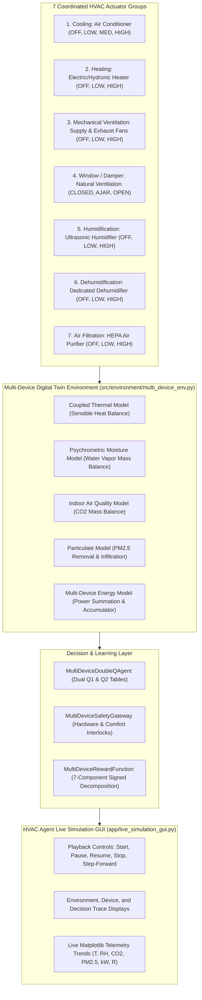

# HVAC_UPGRADE_DESIGN.md
## Multi-Device HVAC Digital Twin & Step-by-Step Agent Control Architecture

- **Project**: SmartHVACControlByDoubleQLearning
- **Document Version**: 2.0.0
- **Date**: 2026-11-18
- **Classification**: RESEARCH_SIMULATION_ONLY
- **Authors**: Antigravity AI Engineering Team & SmartHVAC Core Contributors

---

## 1. Executive Summary & Audit of Current Architecture

An exhaustive audit of the existing codebase (`Project/SmartHVACControlByDoubleQLearning`) was conducted prior to designing this architectural upgrade. The current state is summarized below:

### 1.1 Current Architecture Audit
- **Algorithm**: Tabular Double Q-Learning (`TargetDoubleQLearningAgent`) with two independent value tables ($Q_A, Q_B$) and visit tracking $N(s, a)$. Single Q-Learning (`QLearningAgent`) is implemented as an empirical baseline.
- **State Space**: Exactly 600 discrete states ($10 \text{ Temp} \times 4 \text{ Humidity} \times 3 \text{ Heat Load} \times 5 \text{ Time/Tariff Bins}$).
- **Action Space**: Exactly 5 discrete actions:
  - `0: SET_25` (25°C Setpoint)
  - `1: SET_23` (23°C Setpoint)
  - `2: SET_27` (27°C Setpoint)
  - `3: AC_OFF` (Compressor 0 kW, Window Closed)
  - `4: WINDOW_OPEN` (Natural ventilation, Compressor 0 kW, Window Open)
- **Simulated HVAC Equipment**: Only **2 actuators** are currently modeled:
  1. Air Conditioner compressor (Cooling only: OFF, LOW, MED, HIGH power levels).
  2. Window (Binary state: Closed or Open).
  *Heating, mechanical ventilation fans, humidifiers, dehumidifiers, and air purifiers are currently not modeled or simulated.*
- **Physics Engine**: Coupled 1st-order RC model (`GreyBoxThermalModel`) simulating indoor temperature $T$ and relative humidity $RH$.
- **Reward Function**: Signed additive decomposition ($R = R_{comfort} + R_{safety} + R_{energy} + R_{switching} + R_{humidity}$).
- **Safety Layer**: Independent `SafetyGateway` with overheat override (29.5°C), freeze override (18.0°C), short-cycling protection (2-hour lock), and night/storm window veto.
- **Episode Length**: 24 steps (1 hour per step).
- **Environment Reset**: Resets step to 0, window to closed, last action to None (preventing step 0 switching penalty), clears energy/switching counters, and sets initial conditions from data slice.
- **Q-Table Serialization**: Standard Python `pickle` serialization via `BaseAgent.save()` and `BaseAgent.load()`.
- **GUI Status**: Streamlit application (`app/app.py`). Currently runs episodes in batch loops. In evaluation mode, it does not update the Q-table (`selected_agent.select_action(state, evaluate=True)` with no update step). There is no live step-by-step playback or real-time pause/resume.
- **Unit Test Coverage**: 43 unit tests passing (100% pass rate).

---

## 2. Proposed Architecture: Multi-Device HVAC Digital Twin

To transform the repository into a complete HVAC Digital Twin research environment without disrupting legacy validation, we design a modular extension layer that coexists with the approved baseline.

### 2.1 State Space Extension
The state space is discretized into a 6D tuple designed to capture thermal comfort, humidity, IAQ, occupancy/heat load, and electricity tariff:
1. **Temperature Bin** (5 bins):
   - `0: FREEZING_COLD` ($< 21.0^\circ\text{C}$)
   - `1: COOL` ($[21.0, 24.0)^\circ\text{C}$)
   - `2: OPTIMAL_COMFORT` ($[24.0, 26.0]^\circ\text{C}$)
   - `3: WARM` ($[26.0, 28.5)^\circ\text{C}$)
   - `4: OVERHEATING` ($\ge 28.5^\circ\text{C}$)
2. **Humidity Bin** (3 bins):
   - `0: DRY` ($< 40\%RH$)
   - `1: COMFORTABLE` ($[40, 65]\%RH$)
   - `2: HUMID` ($> 65\%RH$)
3. **CO2 Concentration Bin** (3 bins):
   - `0: EXCELLENT` ($< 800\text{ ppm}$)
   - `1: ACCEPTABLE` ($[800, 1200]\text{ ppm}$)
   - `2: STALE_POOR` ($> 1200\text{ ppm}$)
4. **Air Quality / PM2.5 Bin** (2 bins):
   - `0: GOOD` ($\le 35\ \mu\text{g/m}^3$)
   - `1: POLLUTED` ($> 35\ \mu\text{g/m}^3$)
5. **Internal Heat / Occupancy Load Bin** (2 bins):
   - `0: LOW_LOAD` ($< 3.0\text{ kW}$)
   - `1: HIGH_LOAD` ($\ge 3.0\text{ kW}$)
6. **Time of Day / Tariff Bin** (4 bins):
   - `0: OFF_PEAK_NIGHT` (22:00 - 06:00)
   - `1: MORNING_RAMP` (06:00 - 09:00)
   - `2: MIDDAY_PEAK` (09:00 - 17:00 weekdays)
   - `3: EVENING_SHOULDER` (17:00 - 22:00 weekdays / weekends)

Total Discrete State Cardinality:
$$|S| = 5 \times 3 \times 3 \times 2 \times 2 \times 4 = 720 \text{ states}$$

### 2.2 Action Space: Coordinated Action Templates
To prevent the combinatorial catastrophe ($3^7 = 2,187$ unconstrained combinations), we implement **12 physically valid Coordinated Action Templates**. Each template deterministically defines the actuation setpoints of all 7 device groups:

| Action ID | Template Name | Cooling (AC) | Heating | Vent Fans | Window | Humidifier | Dehumidifier | Air Filter | Primary Operational Goal |
|---|---|---|---|---|---|---|---|---|---|
| **0** | `ALL_OFF_STANDBY` | OFF (0 kW) | OFF (0 kW) | OFF (0 kW) | CLOSED | OFF (0 kW) | OFF (0 kW) | OFF (0 kW) | Baseline minimum energy when unoccupied / idle |
| **1** | `COMFORT_COOL` | Set 25°C (Auto) | OFF | Low (150 m³/h) | CLOSED | OFF | OFF | Low (100 m³/h) | Standard comfort cooling with baseline IAQ |
| **2** | `MAX_COOL` | Set 23°C (High) | OFF | Med (300 m³/h) | CLOSED | OFF | OFF | Med (200 m³/h) | Fast cooling under severe overheating |
| **3** | `ECONOMY_COOL` | Set 27°C (Low) | OFF | Low (150 m³/h) | CLOSED | OFF | OFF | Low (100 m³/h) | Energy-saving cooling during peak tariff |
| **4** | `NATURAL_VENTILATION`| OFF | OFF | OFF | OPEN | OFF | OFF | Low (100 m³/h) | Free cooling & fresh air when outdoor is pleasant |
| **5** | `ACTIVE_VENT_PURIFY` | OFF | OFF | High (500 m³/h) | CLOSED | OFF | OFF | High (400 m³/h) | Rapid CO2 dilution & PM2.5 flush |
| **6** | `COMFORT_HEAT` | OFF | Set 22°C (Low) | Low (150 m³/h) | CLOSED | Low (200 g/h)| OFF | Low (100 m³/h) | Gentle heating & winter moisture maintenance |
| **7** | `MAX_HEAT` | OFF | Set 24°C (High)| Low (150 m³/h) | CLOSED | Med (400 g/h)| OFF | Low (100 m³/h) | Fast heating under cold conditions |
| **8** | `DEHUMIDIFY_ACTIVE` | Set 26°C (Low) | OFF | Low (150 m³/h) | CLOSED | OFF | ON (1.5 kg/h)| Low (100 m³/h) | Moisture removal in humid climates |
| **9** | `HUMIDIFY_COMFORT` | Set 25°C (Low) | OFF | Low (150 m³/h) | CLOSED | High (600 g/h)| OFF | Low (100 m³/h) | Active moisture addition in dry conditions |
| **10** | `ECO_AIR_PURIFY` | OFF | OFF | Low (100 m³/h) | CLOSED | OFF | OFF | High (400 m³/h) | Particulate cleaning without active thermal change |
| **11** | `NIGHT_SETBACK` | Set 26.5°C (Low)| OFF | Low (100 m³/h) | CLOSED | OFF | OFF | Low (100 m³/h) | Quiet night setback for off-peak hours |

Total Action Cardinality: $|A| = 12 \text{ actions}$.
Total Q-Table Size: $|S| \times |A| = 720 \times 12 = 8,640$ entries per table ($Q_A$ and $Q_B$).
This guarantees rapid learning convergence, complete state-action space exploration within reasonable episodes, and mathematically prevents invalid combinations (e.g. heating and cooling simultaneously).

### 2.3 Physical Models & Differential Equations
1. **Thermal Model** (Sensible heat balance):
   $$\rho_{air} V c_p \frac{dT}{dt} = U A (T_{out} - T) + Q_{int} + P_{heat} - COP_{cool} P_{cool} + \dot{m}_{vent} c_p (T_{out} - T) + \dot{m}_{win} c_p (T_{out} - T)$$
2. **Moisture Model** (Water vapor mass balance):
   $$\rho_{air} V \frac{dW}{dt} = \dot{m}_{w,occ} + \dot{m}_{w,humid} - \dot{m}_{w,dehumid} - \dot{m}_{w,ac\_latent} + (\dot{m}_{vent} + \dot{m}_{win}) (W_{out} - W)$$
   With saturation vapor pressure calculated via the Magnus formulation:
   $$P_{sat}(T) = 0.61078 \exp\left(\frac{17.27 T}{T + 237.3}\right) \text{ kPa}$$
   $$P_v = \frac{W P_{atm}}{0.622 + W}$$
   $$RH = 100\% \times \frac{P_v}{P_{sat}(T)}$$
3. **CO2 Model** (Tracer gas mass balance):
   $$V \frac{dC_{CO2}}{dt} = G_{CO2} N_{occ} + (\dot{V}_{vent} + \dot{V}_{win} + \dot{V}_{inf}) (C_{CO2,out} - C_{CO2})$$
4. **Air Quality Model** (PM2.5 particulate mass balance):
   $$V \frac{dC_{PM25}}{dt} = G_{PM25} + (\dot{V}_{win} + \dot{V}_{inf}) C_{PM25,out} + \dot{V}_{vent} (1 - \eta_{filter}) C_{PM25,out} - (CADR_{purifier} + k_{dep} V) C_{PM25}$$
5. **Energy Model**:
   $$P_{total}(t) = P_{cool}(t) + P_{heat}(t) + P_{vent}(t) + P_{exhaust}(t) + P_{humid}(t) + P_{dehumid}(t) + P_{filter}(t)$$
   $$E_{total} = \int P_{total}(t) dt = \sum_{t} P_{total}(t) \Delta t \text{ (kWh)}$$

### 2.4 Multi-Objective Reward Decomposition
$$R_{total} = R_{temp} + R_{humidity} + R_{co2} + R_{air\_quality} + R_{energy} + R_{switching} + R_{safety}$$
Each term has clear units, dedicated weights, and is displayed independently in telemetry.

### 2.5 Multi-Device Safety Layer
Independent deterministic safety interlocks:
- Emergency Overheat Override ($T \ge 29.5^\circ\text{C} \to$ Force `MAX_COOL`).
- Emergency Freeze Override ($T \le 18.0^\circ\text{C} \to$ Force `COMFORT_HEAT` or shutdown cooling).
- Extreme CO2 Flush Override ($C_{CO2} \ge 1600\text{ ppm} \to$ Force ventilation increase).
- Severe Outdoor Pollution / Storm Window Lock (Veto window if $T_{amb} > 33^\circ\text{C}$, $RH_{amb} > 85\%$, or $PM2.5_{out} > 75\ \mu\text{g/m}^3$).
- Anti-Short-Cycling compressor protection (minimum dwell time between transitions).
- Mutual Exclusion Interlocks: Prevent simultaneous heating/cooling and humidifying/dehumidifying.

---

## 3. Implementation Plan & File Additions

### 3.1 New Modules to Implement
1. `src/environment/multi_device_env.py`: Full multi-device HVAC digital twin environment with room geometry, psychrometric moisture balance, CO2, PM2.5, and 7 device actuator models.
2. `src/reward/multi_device_reward.py`: Multi-objective reward function with 7-term signed decomposition and preference weighting.
3. `src/safety/multi_device_safety_gateway.py`: Multi-device safety gateway with interlocks, emergency overrides, and intervention logging.
4. `src/agent/multi_device_double_q_agent.py`: Target Double Q-Learning agent adapted for 720 states and 12 actions with metadata versioning.
5. `app/live_simulation_gui.py`: Dedicated interactive Desktop GUI (Tkinter + embedded Matplotlib) providing Step-by-Step playback, start/pause/resume, simulation speed, environment panel, equipment telemetry, agent decision trace, live trend plots, and decision history table. Adheres to `[ERR-202611-003][gui-combobox-width]`.
6. `run_live_simulation.py`: Convenient entrypoint runner for the new GUI.
7. `train_multi_device_dql.py`: Comprehensive training pipeline for multi-device agent and baselines.
8. `tests/test_multi_device_simulation.py`: Physics consistency, mass balances, non-negative energy, room geometry tests.
9. `tests/test_multi_device_agent.py`: Dual Q-table updates, tie-breaking, evaluation vs online learning tests.
10. `tests/test_multi_device_safety.py`: Safety interlocks, emergency overrides, short-cycling tests.
11. `tests/test_multi_device_reward.py`: Reward decomposition identity, weights configuration tests.

### 3.2 Documentation Deliverables
- `AGENT_LEARNING_EXPLAINED.md`
- `HVAC_SIMULATION_ASSUMPTIONS.md`
- `HVAC_ACTION_SPACE.md`
- `HVAC_REWARD_DESIGN.md`
- `HVAC_SCOPE_AND_COVERAGE.md`
- Updates to existing project reports (`README.md`, `IMPLEMENTATION_STATUS.md`, `TECHNICAL_LIMITATIONS.md`, `FINAL_VALIDATION_STATUS.md`, `TRAINING_AND_EVALUATION.md`, `PHYSICAL_MODEL_VALIDATION.md`, `REAL_WORLD_READINESS.md`, `GENERALIZATION_BENCHMARK.md`).

---

## 4. Compatibility & Regression Risk Analysis

| Risk Area | Risk Level | Mitigation Strategy |
|---|---|---|
| **Breaking Existing 43 Unit Tests** | HIGH | Leave legacy modules (`target_env.py`, `target_double_q_agent.py`, `greybox_model.py`, `safety_gateway.py`, `advanced_reward.py`) completely intact and backwards-compatible. New multi-device capabilities are added in modular companion classes. |
| **Q-Table Dimension Mismatch** | MEDIUM | Version all serialized models with metadata schema (`schema_version: "2.0-multi-device"` vs `"1.0-target-600s"`). Explicit rejection if attempting to load incompatible checkpoints. |
| **Scientific Overclaiming** | HIGH | Explicitly tag all synthetic parameters with `SIMULATED_ASSUMED` or `SIMULATED`. Maintain status as `RESEARCH_SIMULATION_ONLY`. Avoid claims of real-world deployment. |
| **GUI Responsiveness & Tkinter Layout** | LOW | Use Tkinter's non-blocking `.after()` loop for simulation speed (0.25x to 5x) without UI freezing. Follow directive `[ERR-202611-003]` with wide dedicated rows for comboboxes. |

---
**Status**: APPROVED FOR IMPLEMENTATION.
Proceeding with codebase construction.
