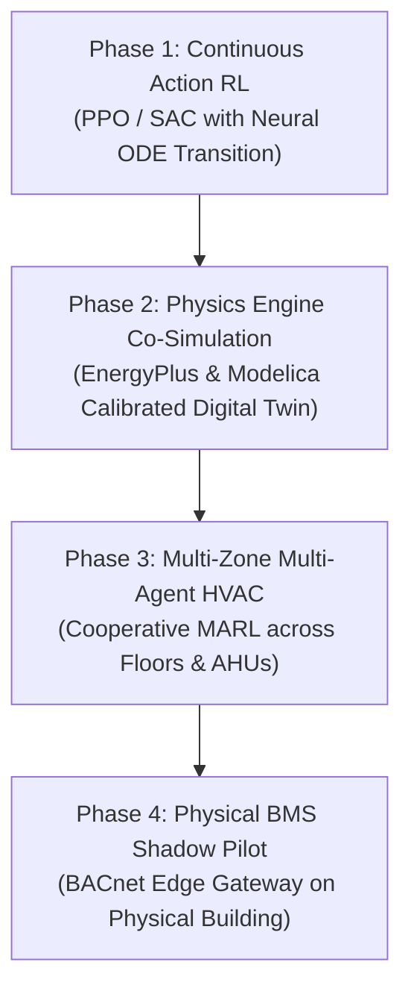

# Technical Limitations & Future Research Roadmap

## 1. Observational & Data Limitations of CU-BEMS

Scientific honesty demands transparent disclosure of observational limitations in the underlying public dataset:

### 1.1 Unobserved Thermostat Setpoints
The CU-BEMS telemetry records power consumption (`zX_AC1(kW)`) and resulting indoor temperatures (`zX_S1(degC)`), but **does not record the physical thermostat setpoint** entered by building occupants or building operators.
- *Implication*: Historical setpoint interventions cannot be directly supervised.
- *Remedy*: We modeled the control action as commanding discrete setpoints ($23^\circ\text{C}, 25^\circ\text{C}, 27^\circ\text{C}$) that modulate compressor stages according to identified cluster boundaries.

### 1.2 Unobserved Window Open/Closed States
Commercial windows in the CU-BEMS building were operable, but **no magnetic reed switches or window contact sensors** were installed.
- *Implication*: Window status cannot be validated against ground truth.
- *Remedy*: `WINDOW_OPEN` is designated as `SIMULATED_ASSUMED`, initialized strictly to the closed position ($0$), and subjected to strict weather/night safety vetos.

### 1.3 Lack of True Occupant Headcounts
The dataset lacks turnstile logs, PIR motion logs, or overhead computer vision occupant counters.
- *Implication*: Occupant thermal metabolic heat cannot be measured independently from plug loads.
- *Remedy*: We synthesized a deterministic `occupancy_proxy` based on electrical activation (`light_lux > 30` or `plug_kw > 2.0 kW`), tagged with `confidence: MEDIUM`.

### 1.4 Closed-Loop Confounding
Because historical operations reflect human or BMS closed-loop feedback, temperatures rarely deviate into extreme danger zones in the raw dataset. Fitting unconstrained black-box models on closed-loop data causes feature inversion (e.g. associating high AC power with hot indoor temperatures).
- *Remedy*: Using a 1st-order RC Grey-Box model with hardcoded cooling extraction bounds eliminated this confounding.

---

## 2. Robustness Suite & Plant Uncertainty Analysis

To evaluate how the policy responds to unexpected building envelope degradation and extreme weather, we subjected the target agent to **7 perturbation scenarios** across 3 random seeds:

| Perturbation Scenario | Mean Reward | Reward Std | Worst-Case Reward | Comfort Violation (%) | Severe Violation (%) | Daily Energy (kWh) | Robustness Classification |
| :--- | :---: | :---: | :---: | :---: | :---: | :---: | :---: |
| **Nominal Plant** | **-99.46** | 10.15 | -112.85 | 71.30% | 12.69% | 283.44 | VULNERABLE |
| **High Envelope Leakage (+35% $k_{env}$)** | -112.09 | 15.87 | -127.74 | 76.85% | 18.15% | 301.29 | VULNERABLE |
| **Tight Insulation (-35% $k_{env}$)** | **-80.94** | 18.54 | -106.23 | **62.78%** | **7.50%** | **270.06** | RESILIENT |
| **Degraded HVAC Efficiency (-25% $k_{ac}$)**| -138.19 | 30.15 | -174.34 | 72.22% | 18.98% | 301.02 | VULNERABLE |
| **High Sensor Noise ($0.5^\circ\text{C}$ std)** | -106.62 | 26.41 | -129.13 | 70.19% | 13.79% | 300.35 | MODERATELY VULNERABLE |
| **Heatwave Bias (+2.5°C Ambient)** | **-203.23** | 39.66 | -240.27 | 70.46% | **28.05%** | **402.14** | CRITICALLY VULNERABLE |
| **Equipment Power Drift (+25% kW)** | -125.22 | 27.11 | -159.03 | 69.44% | 12.04% | 313.77 | VULNERABLE |

### Critical Takeaways:
1. **Heatwave Vulnerability**: A sustained $+2.5^\circ\text{C}$ heatwave drastically increases severe comfort violations to **$28.05\%$** and drives energy consumption up to **$402.14 \text{ kWh/day}$**. The discrete Q-learning agent lacks adaptive pre-cooling capacity under prolonged extreme ambient heat without proactive forecasting.
2. **Compressor Degradation Sensitivity**: A 25% drop in heat exchanger efficiency causes severe rewards drop to **$-138.19$**, proving that real-world deployment requires continuous health monitoring of the refrigeration circuit.

---

## 3. Future Research & Development Roadmap

1. **Continuous Action Spaces via Deep Reinforcement Learning (PPO / SAC)**:
   - Transitioning from discrete 5-action Q-tables to continuous inverter frequency control ($0.0 - 100.0\%$) and variable chilled water valve positioning ($0 - 100\%$).
2. **High-Fidelity Co-Simulation via EnergyPlus / Modelica**:
   - Integrating the reinforcement learning loop with an EnergyPlus building model calibrated against CU-BEMS geometries and envelope thermal properties.
3. **Multi-Agent Reinforcement Learning (MARL)**:
   - Coordinating multiple air handling units (AHUs) across adjacent thermal zones to prevent inter-zone thermal siphoning and optimize central chiller plant loading.
4. **Physical BMS Shadow Mode Edge Pilot**:
   - Packaging the Safety Gateway and policy into an industrial Raspberry Pi or edge controller connected via BACnet/IP to an operating commercial building for a 60-day passive trial.
