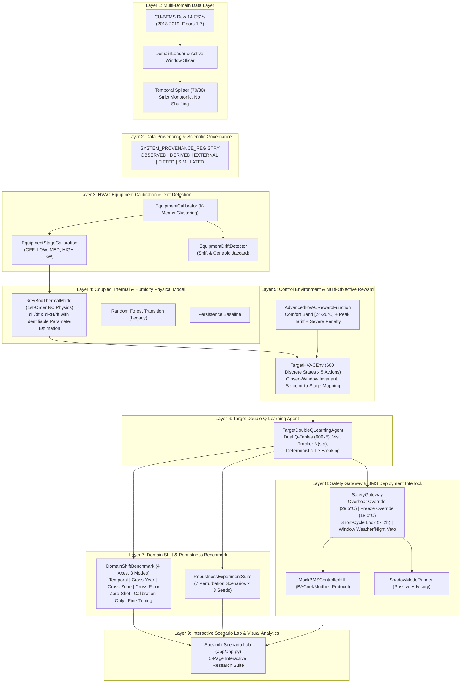

# SmartHVACControlByDoubleQLearning — Project Architecture

## Executive Overview
The **SmartHVACControlByDoubleQLearning** platform is an evidence-based, physics-informed reinforcement learning framework for smart building heating, ventilation, and air conditioning (HVAC) control. The architecture is engineered around the core requirement of **cross-domain generalization and physical validity**, ensuring clear separation between raw observations, statistical parameter estimation, simulated operational hypotheses, policy optimization, and physical safety interlocks.

---

## 9-Layer System Architecture

---

## Detailed Architectural Layers

### Layer 1: Multi-Domain Data Layer (`src/data/domain_loader.py`, `src/data/domain_config.py`)
- **Domain Catalog**: Supports multi-domain specifications (`DomainSpec`) covering 2018 and 2019 across floors 2 and 3, zones 1 and 2.
- **Active Sensor Window Detection**: Detects sensor outages dynamically. For instance, in `2018Floor2.csv`, temperature readings are only valid from July to September 2018. The loader slices only active continuous intervals.
- **Leakage-Free Temporal Splitting**: The `split_temporal_dataset()` function strictly preserves temporal ordering. The first 70% of chronological records are assigned to training, and the final 30% are held out for testing. No cross-validation shuffling or lookahead operations occur.

### Layer 2: Data Provenance & Scientific Governance (`src/data/provenance.py`)
Every measurement, state variable, parameter, and operational hypothesis in the codebase is assigned an immutable provenance record:
- `OBSERVED`: Ground-truth physical transducer readings from building loggers (`temp_c`, `humidity_rh`, `hvac_kw`, `plug_kw`, `light_kw`).
- `DERIVED`: Deterministic algebraic combinations (`internal_heat_kw = plug + light`, `occupancy_proxy`).
- `EXTERNAL`: Meteorological diurnal models aligned to Bangkok climatology (`ambient_temp_est`, `ambient_rh_est`).
- `FITTED_WITH_CAVEAT`: Physically bounded coefficients identified from data subject to closed-loop operating limitations ($k_{env}, k_{int}, k_{ac}, h_{env}, h_T, h_{ac}$).
- `SIMULATED_ASSUMED`: Decision hypotheses required for simulation but not recorded in raw telemetry (`sim_ac_setpoint`, `sim_window_open`).

### Layer 3: HVAC Equipment Calibration & Drift Detection (`src/data/calibration.py`)
- **K-Means Clustering**: Active compressor load profiles ($P > 0.5$ kW) are clustered into discrete operating modes:
  $$\text{Stages} \in \{\text{OFF } (0 \text{ kW}), \text{LOW}, \text{MEDIUM}, \text{HIGH}\}$$
- **Physical Equipment Drift**: Identifies significant equipment alterations across operational years. For 2018 Zone 1, the LOW stage was $12.50$ kW, whereas in 2019 it jumped to $19.66$ kW (+60.6% shift), triggering automated drift alarms.

### Layer 4: Coupled Thermal & Humidity Physical Environment Model (`src/environment/greybox_model.py`)
Replaces unconstrained black-box estimators with a physically consistent 1st-order Resistance-Capacitance (RC) thermodynamic model:
$$\frac{dT}{dt} = k_{env}(T_{amb} - T) + k_{int} P_{int} - k_{ac} P_{hvac} + k_{win} W (T_{amb} - T)$$
$$\frac{dRH}{dt} = h_{env}(RH_{amb} - RH) + h_T \frac{dT}{dt} - h_{ac} P_{hvac} + h_{win} W (RH_{amb} - RH)$$
- **Guaranteed Monotonicity**: Applying higher cooling power $P_{hvac}$ strictly decreases indoor temperature.
- **Psychrometric Coupling**: Implements Clausius-Clapeyron thermodynamics ($h_T = -2.35$ %RH/°C).

### Layer 5: Control Environment & Advanced Multi-Objective Reward (`src/environment/target_env.py`, `src/reward/advanced_reward.py`)
- **600 Discrete States**: Discretized into 4 independent dimensions:
  1. Temperature ($10$ bins: $<20^\circ\text{C}$ to $\ge 28.5^\circ\text{C}$)
  2. Relative Humidity ($4$ bins: $<45\%$ to $\ge 65\%$)
  3. Internal Heat Load ($3$ bins: $<2$ kW, $2-6$ kW, $\ge 6$ kW)
  4. Time of Day / Tariff ($5$ bins: Night, Morning Ramp, Midday Peak, Evening Shoulder, Weekend)
- **5 Discrete Actions**: `0: SET_25` (25°C), `1: SET_23` (23°C), `2: SET_27` (27°C), `3: AC_OFF` (0 kW), `4: WINDOW_OPEN` (Natural ventilation).
- **Multi-Objective Reward**:
  $$R_t = R_{comfort} + R_{severe\_comfort} + R_{humidity} + R_{energy} + R_{switching} + R_{window}$$
  Penalizes deviations outside $[24^\circ\text{C}, 26^\circ\text{C}]$, applies quadratic penalties below $21^\circ\text{C}$ and above $29^\circ\text{C}$, incorporates Time-of-Use (TOU) electricity pricing, and penalizes compressor hunting.

### Layer 6: Target Double Q-Learning Agent (`src/agent/target_double_q_agent.py`)
- **Decoupled Value Estimation**: Maintains two independent Q-value estimators ($Q_A$ and $Q_B$) with $600 \times 5 = 3,000$ entries each.
- **Exploration Tracking**: Tracks visit counts $N(s, a)$ across all 3,000 state-action pairs.
- **Deterministic Tie-Breaking**: Resolves equal-value actions deterministically using a seeded pseudo-random generator, avoiding arbitrary first-index bias.

### Layer 7: Generalization Benchmark & Robustness Suite (`src/evaluation/benchmark_suite.py`, `src/evaluation/robustness_suite.py`)
- **4 Benchmark Axes**: Temporal, Cross-Year, Cross-Zone, Cross-Floor.
- **3 Transfer Modes**: `ZERO-SHOT` (frozen model, source calibration), `CALIBRATION-ONLY` (frozen model, target equipment calibration), `FINE-TUNING` (target calibration + 25 target training episodes).
- **Robustness Perturbations**: Evaluates the agent under 7 environmental and plant uncertainty scenarios across 3 random seeds.

### Layer 8: Safety Gateway & BMS Deployment Interfaces (`src/safety/safety_gateway.py`, `src/safety/hil_interface.py`)
- **Safety Interlock**: Operates downstream of the agent with unilateral veto power.
  - Overheat Override: If $T_{indoor} \ge 29.5^\circ\text{C}$, forces `SET_23`.
  - Freeze Override: If $T_{indoor} \le 18.0^\circ\text{C}$, forces `AC_OFF`.
  - Compressor Short-Cycle Protection: Prevents toggling between cooling and off within 2 hours.
  - Window Veto: Blocks window opening at night (22:00–06:00) or under extreme weather ($T_{amb} > 33^\circ\text{C}$ or $RH_{amb} > 85\%$).
- **BMS Interfaces**:
  - `MockBMSControllerHIL`: Emulates standard BACnet MS/TP and Modbus TCP telemetry and actuator command dispatch.
  - `ShadowModeRunner`: Evaluates agent recommendations passively against live operator actions without commanding equipment.

### Layer 9: Interactive Scenario Lab (`app/app.py`)
- **Streamlit Application**: Multi-page interactive graphical environment offering:
  1. Executive Summary & Architecture Overview.
  2. Transition Model Diagnostics (Monotonicity curves, multi-step rollouts).
  3. Interactive Episode Simulator with live Safety Gateway overrides.
  4. Cross-Domain Generalization Benchmarks.
  5. Shadow Mode BMS Telemetry Inspector.
