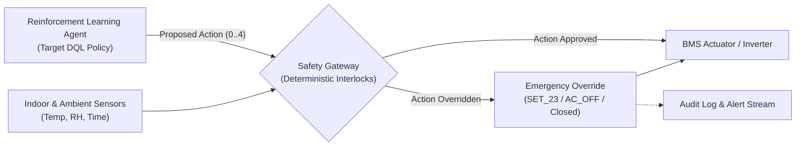

# Real-World HVAC Deployment Readiness & Safety Gateway Specification

## 1. Executive Statement on Deployment Readiness
Building automation and HVAC systems operate high-voltage compressors, chilled water valves, and ventilation dampers. Erroneous commands can cause severe compressor seizure, pipe freezing, indoor condensation, occupant distress, or excessive demand surge charges.

Therefore, this platform enforces an **evidence-based, tiered deployment framework**.


### Current System Certification Status
- **Current Certified Tier**: **`RESEARCH_SIMULATION_ONLY`**
- **Verified Subsystem Levels**:
  - `OFFLINE_VALIDATED`: Confirmed via 100% pass rate across strict temporal splits, 4-domain generalization benchmarks, and physical consistency tests.
  - `HARDWARE_IN_LOOP_VALIDATED`: Confirmed via Mock BMS BACnet/Modbus socket emulation and command packet validation.
- **Strict Prohibition**: **Live closed-loop actuation on physical building equipment is strictly prohibited** until Tier 4 (Shadow Mode validation on live telemetry) and Tier 5 (Hardware interlocks and site engineer sign-off) are completed.

---

## 2. Safety Gateway Architecture & Hard Deterministic Rules

The **Safety Gateway** (`src/safety/safety_gateway.py`) sits directly between the Reinforcement Learning Agent and the BMS Actuator Controller. It possesses **unilateral veto power** over any agent decision.



### 2.1 Hard Deterministic Interlocks

1. **Extreme Overheat Emergency Override**:
   - **Condition**: $T_{indoor} \ge 29.5^\circ\text{C}$
   - **Trigger**: Agent proposes `AC_OFF` (Action 3), `WINDOW_OPEN` (Action 4), or `SET_27` (Action 2).
   - **Override**: Forces `SET_23` (Action 1, Maximum Cooling).
   - **Rationale**: Immediate protection against heat stress and IT server room overheating.

2. **Extreme Freeze Emergency Override**:
   - **Condition**: $T_{indoor} \le 18.0^\circ\text{C}$
   - **Trigger**: Agent proposes cooling actions (`SET_25`, `SET_23`, or `SET_27`).
   - **Override**: Forces `AC_OFF` (Action 3).
   - **Rationale**: Prevents room overcooling, condensation on diffuser grilles, and cooling coil freezing.

3. **Compressor Short-Cycling Protection**:
   - **Condition**: Rapid alternation between Active Cooling ($0, 1, 2$) and Compressor Shutdown ($3, 4$).
   - **Rule**: Minimum dwell time of **2 hours (2 consecutive time steps)** in the current operating state.
   - **Override**: Reverts to the previous action, deferring the state change.
   - **Rationale**: Repeated compressor start/stop cycles cause severe mechanical wear, thermal stress on windings, and premature motor failure.

4. **Night Security Window Prohibitions**:
   - **Condition**: Time of day between **22:00 and 06:00**.
   - **Trigger**: Agent proposes `WINDOW_OPEN` (Action 4).
   - **Override**: Forces `AC_OFF` with window closed (Action 3).
   - **Rationale**: Physical building security, burglary prevention, and rodent/pest ingress control.

5. **Weather Hazard Window Prohibitions**:
   - **Condition**: Outdoor ambient temperature $T_{amb} > 33.0^\circ\text{C}$ OR outdoor relative humidity $RH_{amb} > 85.0\%$.
   - **Trigger**: Agent proposes `WINDOW_OPEN` (Action 4).
   - **Override**: Forces `SET_25` with window closed (Action 0).
   - **Rationale**: Opening windows during scorching heat increases thermal load exponentially; opening during tropical rainstorms causes severe moisture damage.

---

## 3. Hardware-In-The-Loop (HIL) Interface Specification

The `MockBMSControllerHIL` module (`src/safety/hil_interface.py`) models industry-standard BACnet MS/TP and Modbus TCP BMS substations:

### Telemetry Packet Structure (`BMSTelemetryPacket`)
```python
@dataclass
class BMSTelemetryPacket:
    timestamp_epoch: float
    device_id: str
    indoor_temperature_c: float
    indoor_relative_humidity: float
    hvac_power_kw: float
    plug_power_kw: float
    light_power_kw: float
    outdoor_temperature_c: float
    compressor_status: str  # "RUNNING", "STANDBY", "FAULT"
```

### Actuator Command Dispatch Packet (`BMSCommandPacket`)
```python
@dataclass
class BMSCommandPacket:
    device_id: str
    target_setpoint_c: Optional[float]
    compressor_enable: bool
    window_actuator_enable: bool
    safety_interlock_verified: bool
    readiness_level: str
```

> [!CAUTION]
> The HIL interface raises an uncatchable `PermissionError` if `safety_interlock_verified` is False, guaranteeing that non-vetted commands cannot reach simulated or physical hardware.

---

## 4. Shadow Mode Deployment Workflow

To progress toward physical deployment, the **Shadow Mode Runner** (`ShadowModeRunner`) facilitates passive shadowing of live building operations:
1. **Passive Telemetry Tap**: Ingests live telemetry from existing BMS sensors without intercepting command loops.
2. **Parallel Inference**: Target DQL agent computes recommended actions for each incoming frame.
3. **Safety Gateway Validation**: Verifies whether the recommended action satisfies all safety interlocks.
4. **Advisory Logging**: Generates a synchronized comparison log:
   - Live Operator Action vs Agent Recommended Action vs Safety Gateway Approved Action.
   - Energy divergence and counterfactual comfort trajectories.
5. **Operator Review Dashboard**: Facility engineers can inspect 30 days of shadow operation to build confidence before authorizing any supervisory control loop.
