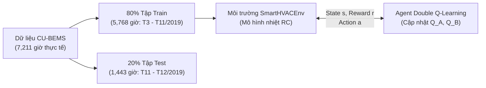

# Data

This directory contains the datasets used throughout the project.

## Purpose

The `data` directory separates raw, processed, and sample datasets to keep the data pipeline organized and reproducible.

## Structure

```text
data/
├── raw/
├── processed/
└── sample/

```

---

## Cơ Chế Sử Dụng Dữ Liệu CU-BEMS Trong Huấn Luyện Học Tăng Cường (Reinforcement Learning)

Trong bài toán **Học tăng cường (Reinforcement Learning - RL)**, dữ liệu **không được dùng theo kiểu Học có giám sát (Supervised Learning - có sẵn nhãn y để tính loss)**. Thay vào đó, dữ liệu CU-BEMS được sử dụng làm **"Môi trường ngoại cảnh chuỗi thời gian thực tế" (Data-driven Environment)** để Agent tương tác, thử-sai và tối ưu hóa chính sách điều khiển.

### 1. Phân biệt: Dữ Liệu Tĩnh vs Dữ Liệu Trong Học Tăng Cường
- **Học có giám sát (Supervised Learning):** Dùng trực tiếp nhãn hành động trong quá khứ. Nếu làm cách này, Agent chỉ "học vẹt" cách điều khiển cũ của con người (bao gồm cả những lúc người cũ điều khiển kém: làm lạnh quá đà xuống 18°C gây lãng phí điện, hoặc tắt điều hòa khiến phòng quá nóng 30°C).
- **Học tăng cường (Reinforcement Learning):** Dữ liệu CU-BEMS được tách bạch thành 2 thành phần:
  - **Dữ liệu ngoại cảnh khách quan (Exogenous Disturbances):** Phụ tải máy tính/ổ cắm (`plug_kw`), chiếu sáng (`light_kw`), thời điểm trong ngày (`hour`, `dayofweek`, `is_workhour`). Đây là các tải nhiệt thực tế của người sử dụng trong tòa nhà.
  - **Hành động điều hòa (`hvac_kw`):** Không dùng nhãn cũ trong file, mà **Agent tự quyết định** (chọn công suất 0 kW, 10 kW, 22 kW hay 38 kW) để tìm ra chiến lược tối ưu nhất.

---

### 2. Bốn Bước Dữ Liệu Được Đưa Vào Quá Trình Huấn Luyện



#### Bước 1: Hiệu chuẩn mô hình truyền nhiệt phòng (Thermal Model Calibration)
Từ các chuỗi thời gian thực tế trong CU-BEMS, hệ số truyền nhiệt vật lý của tòa nhà được xác định tại `src/environment/thermal_model.py`:
$$T_{in}(t+1) = T_{in}(t) + \alpha_{amb}(T_{amb}(t) - T_{in}(t)) + \beta_{int} P_{int}(t) - \gamma_{cool} P_{hvac}(a_t) + \epsilon_t$$
- **Hệ số $\beta_{int} = 0.052^\circ\text{C}/\text{kW}$:** Đo lường mỗi kW nhiệt sinh ra từ máy móc văn phòng (`plug_kw`) và đèn (`light_kw`) trong dữ liệu thực tế làm phòng ấm lên bao nhiêu.
- **Hệ số $\gamma_{cool} = 0.038^\circ\text{C}/\text{kW}$:** Đo lường công suất điều hòa sẽ rút bao nhiêu nhiệt ra khỏi phòng.
- **Hệ số $\alpha_{amb} = 0.20$:** Đo lường mức độ ảnh hưởng của nhiệt độ không khí bên ngoài qua tường kính tòa nhà.

#### Bước 2: Phân chia dữ liệu theo trục thời gian (Train / Test Split)
Bộ dữ liệu gồm **7,211 giờ** liên tục được chia thành:
- **Tập Train (80% đầu = 5,768 giờ, từ tháng 3 đến đầu tháng 11/2019):** Chứa đủ các chu kỳ mùa nóng cao điểm, các tuần làm việc đông người và cuối tuần nghỉ lễ để Agent học.
- **Tập Test (20% sau = 1,443 giờ, từ tháng 11 đến hết tháng 12/2019):** Giữ hoàn toàn độc lập làm dữ liệu "chưa từng thấy" (Unseen Test Data) để kiểm định năng lực của Agent.

#### Bước 3: Đưa chuỗi dữ liệu vào từng Episode (Tương tác MDP)
Trong mã nguồn `train.py`, Agent được huấn luyện qua **600 episodes** (mỗi episode mô phỏng 1 ngày 24 giờ):
1. **Khởi tạo (`env.reset()`):** Môi trường chọn ngẫu nhiên một ngày trong 5,768 giờ tập Train và khởi tạo một nhiệt độ phòng ban đầu (ví dụ: 26°C - 28°C).
2. **Tại mỗi bước giờ $t \in [0, 23]$:**
   - **Đọc trạng thái ($s_t$):** Môi trường lấy các giá trị thực tế của dòng dữ liệu tại thời điểm đó:
     $$\text{State } s_t = (\text{Mức nhiệt hiện tại}, \text{Tải nhiệt nội tại } P_{int}(t), \text{Khung giờ trong ngày } H(t))$$
   - **Agent chọn hành động ($a_t$):** Theo chiến lược $\epsilon$-greedy:
     - Khám phá (Exploration): Chọn ngẫu nhiên công suất (0, 10, 22, hoặc 38 kW).
     - Khai thác (Exploitation): Chọn hành động có giá trị $Q(s_t, a)$ cao nhất.
   - **Chạy mô hình vật lý:** Môi trường áp dụng $a_t$ vừa chọn kết hợp với phụ tải máy móc thực tế $P_{int}(t)$ để tính nhiệt độ phòng của giờ tiếp theo $T_{in}(t+1)$.
   - **Tính Reward ($r_t$):**
     - Nếu $T_{in}(t+1) \in [22^\circ\text{C}, 24.5^\circ\text{C}]$: Được cộng điểm thưởng tiện nghi.
     - Nếu nóng hơn $24.5^\circ\text{C}$ hoặc lạnh hơn $22^\circ\text{C}$: Bị phạt (phạt nặng hơn nếu trong giờ làm việc).
     - Luôn bị trừ chi phí tỷ lệ với lượng điện năng mà hành động $a_t$ đã tiêu thụ.

#### Bước 4: Cập nhật tri thức vào 2 bảng $Q_A$ và $Q_B$ (Double Q-Learning)
Tại mỗi bước $(s_t, a_t, r_t, s_{t+1})$, Agent cập nhật bảng Q tại `src/agent/double_q_learning_agent.py`:
- Tung đồng xu 50%:
  - Nếu ngửa: Dùng bảng $Q_A$ để tìm hành động tốt nhất ở trạng thái mới $a^* = \arg\max Q_A(s_{t+1}, a)$, nhưng dùng bảng $Q_B$ để ước lượng giá trị $Q_B(s_{t+1}, a^*)$. Sau đó cập nhật $Q_A$.
  - Nếu sấp: Làm ngược lại (dùng $Q_B$ chọn hành động, dùng $Q_A$ định giá, rồi cập nhật $Q_B$).
- Sau mỗi ngày (episode), tỷ lệ thử ngẫu nhiên $\epsilon$ giảm dần ($\epsilon \leftarrow \epsilon \times 0.995$). Đến episode thứ 400 trở đi, Agent gần như không chọn bừa nữa mà tận dụng tối đa tri thức tối ưu đã tích lũy trong 2 bảng Q.

---

### 3. Quy Luật Mà Agent Đã Học Được Từ Dữ Liệu CU-BEMS
Qua quá trình tương tác với dữ liệu CU-BEMS:
1. **Học được quán tính nhiệt của phòng:** Nhận biết khi nào tải máy móc và đèn văn phòng bắt đầu tăng mạnh (khoảng 8h - 9h sáng) để bật làm mát đón đầu (pre-cooling), tránh để nhiệt độ vọt lên quá cao gây phạt nặng.
2. **Học được cách tiết kiệm điện giờ cao điểm:** Vào buổi chiều (12h - 18h) khi giá điện cao điểm được áp dụng, nếu nhiệt độ phòng đã đủ mát, Agent ưu tiên hạ về mức LOW (10 kW) thay vì chạy HIGH (38 kW).
3. **Tắt điều hòa đúng lúc:** Nhận diện ban đêm và cuối tuần khi phụ tải nội tại thấp ($<2\text{ kW}$) thì chuyển về OFF (0 kW), cho phép nhiệt độ tự nhiên dao động mà không bị phạt tiện nghi vì không có người trong phòng.
